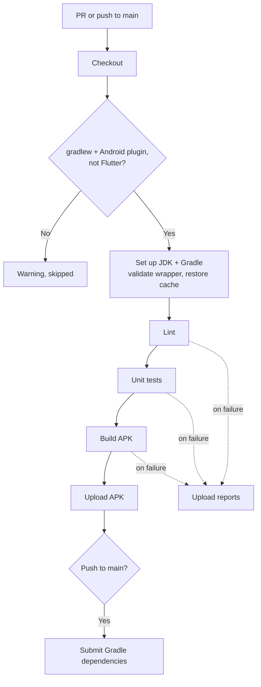

# Android CI

Workflow that checks every PR and push of an Android app or library built with Gradle
(Kotlin DSL or Groovy). It runs:

| Step | Gradle task (variant `debug`) | What it checks |
|---|---|---|
| **Lint** | `lintDebug` | Android Lint: API levels, resources, manifest, accessibility, security |
| **Unit tests** | `testDebugUnitTest` | Tests in `src/test/`, on the JVM (no emulator) |
| **Build APK** | `assembleDebug` | The app compiles and packages; the APK is uploaded as an artifact |

On pushes to `main` (and manual or scheduled runs on it), a second job sends the resolved Gradle dependencies to GitHub's
dependency graph (see [Dependency graph](#dependency-graph)).

- Workflow: [`.github/workflows/android-ci.yml`](../.github/workflows/android-ci.yml)
- Caller sample (call mode): [`examples/android-ci.yml`](../examples/android-ci.yml)
- Actions: `actions/setup-java` v6.1.0, `gradle/actions` v6.4.0 (`setup-gradle` and
  `dependency-submission`) and `actions/upload-artifact` v7.0.2, pinned by commit SHA
- Repo access: `contents: read` for the build; `contents: write` only for the dependency graph
  job, on `main` only. No secrets.

---

## Requirements

- The **Gradle wrapper committed**: `gradlew`, `gradle/wrapper/gradle-wrapper.jar` and
  `gradle-wrapper.properties`. Without `gradlew`, the workflow skips with a warning.
- An **Android Gradle plugin** (`com.android.application` or `com.android.library`) in the
  build files or the version catalog. A plain JVM Gradle project is skipped with a warning.
- **Not a Flutter project.** A Flutter app's `android/` folder needs the Flutter SDK, so it's
  skipped with a warning: use `flutter-ci.yml`.
- For the dependency graph job only: **Dependency graph** enabled in **Settings → Advanced
  Security**. Without it, that job leaves a warning and the run stays green.

The Android SDK comes preinstalled on GitHub's Ubuntu runners. If the project needs a
platform or build tools that aren't there, Gradle downloads them.

---

## Usage

The same file supports two modes. Pick one per repo.

| | A) Copy (main use) | B) Call |
|---|---|---|
| Works for | Any repo, any organization | Any repo, any organization whose Actions policy allows workflows from `rubone/shared-workflows` |
| What goes in the project repo | The whole `android-ci.yml` | A short caller ([example](../examples/android-ci.yml)) |
| Where values go | Top-level `env:` of the copied file | `with:` inputs in the caller |
| Trigger | `on:` in the copied file (PRs and pushes to `main`) | `on:` in the caller |

### A) Copy

1. Copy [`.github/workflows/android-ci.yml`](../.github/workflows/android-ci.yml) to
   `.github/workflows/` in the target repo.
2. If the project isn't at the root, set `WORKING_DIRECTORY`. With flavors, set `VARIANT`
   (see below).
3. If the default branch isn't `main`, change `on.pull_request.branches` and
   `on.push.branches`.

### B) Call

```yaml
name: Android CI

on:
  pull_request:
    branches: [main]
  push:
    branches: [main]

permissions: {}

jobs:
  android-ci:
    permissions:
      contents: write   # only the dependency graph job uses it, on pushes to main
    uses: rubone/shared-workflows/.github/workflows/android-ci.yml@v1
```

The calling job must grant `contents: write`, even though the build job only uses `read`:
GitHub rejects the whole workflow if a nested job asks for more than the caller grants. With
`submit_dependencies: 'false'` the job never runs, but the permission is still needed.

---

## Values

| `env` (copy) | Input (call) | Default | Description |
|---|---|---|---|
| `WORKING_DIRECTORY` | `working_directory` | `.` | Folder with `gradlew`, relative to the repo root. |
| `JAVA_VERSION` | `java_version` | `21` | JDK to run Gradle and compile. AGP 8+ needs 17 or newer. |
| `JAVA_DISTRIBUTION` | — | `temurin` | JDK distribution for `actions/setup-java`. |
| `VARIANT` | `variant` | `debug` | Variant for the tasks: build type, or flavor + build type in camelCase. |
| `STEPS` | `steps` | `lint,test,assemble` | Steps to run, comma-separated. |
| `APK_RETENTION_DAYS` | `apk_retention_days` (number) | `7` | Days to keep the APK artifact (1–90). |
| `SUBMIT_DEPENDENCIES` | `submit_dependencies` | `'true'` | Submit Gradle dependencies to the dependency graph on pushes, manual and scheduled runs on `main`. |
| `GRADLE_CACHE_PROVIDER` | — | `basic` | Gradle cache: `basic` or `enhanced` (see [Gradle cache](#gradle-cache)). |

In call mode, an empty input (or `0` for the number) falls back to the `env` value.

Outputs: none. The job summary shows each step's result, the unit test totals and the APK.

### Variants and flavors

The tasks come from `VARIANT`:

| Project | `VARIANT` | Tasks |
|---|---|---|
| No flavors | `debug` | `lintDebug`, `testDebugUnitTest`, `assembleDebug` |
| Flavors `dev`, `prod` | `devDebug` | `lintDevDebug`, `testDevDebugUnitTest`, `assembleDevDebug` |
| Two flavor dimensions (`free`/`paid` × `dev`/`prod`) | `freeDevDebug` | `lintFreeDevDebug`, … |

Use a `debug` variant: `release` needs a signing key, which this workflow doesn't handle.
To check several flavors, call the workflow once per variant with a matrix:

```yaml
jobs:
  android-ci:
    strategy:
      fail-fast: false
      matrix:
        variant: [devDebug, prodDebug]
    permissions:
      contents: write
    uses: rubone/shared-workflows/.github/workflows/android-ci.yml@v1
    with:
      variant: ${{ matrix.variant }}
```

### Gradle cache

`setup-gradle` caches the Gradle User Home (dependencies, wrapper, build cache). It offers two
implementations:

| `GRADLE_CACHE_PROVIDER` | License | Cost |
|---|---|---|
| `basic` (default here) | MIT, on top of `actions/cache` | Free for every repo |
| `enhanced` (the action's own default) | Proprietary ([Gradle Technologies Terms of Use](https://gradle.com/legal/gradle-technologies-terms-of-use/)) | Free for public repos; a free preview for private repos, with usage-based pricing planned for large organizations |

`enhanced` restores faster and cleans up better, but private repos would depend on terms that
may change. Set it in the copied file if you accept them. The cache is only written on `main`;
PR branches read it.

### Artifacts

- **APK:** `apk-<variant>-<folder>`, after a successful build, kept `APK_RETENTION_DAYS` days.
  It's a debug build signed with the default debug key: fine to install for testing, not to
  publish.
- **Reports:** `reports-<variant>-<folder>`, only when a step fails: the HTML reports of Lint
  and the unit tests (`build/reports/`), kept 7 days.

---

## Dependency graph

GitHub can't read Gradle dependencies from `build.gradle.kts` by itself. Without them,
Dependabot doesn't alert about vulnerable Android libraries.

On every push to `main`, the **Submit Gradle dependencies** job runs Gradle to resolve every
dependency (direct and transitive) and sends the list to GitHub. After that:

- **Dependabot alerts** cover the app's libraries (**Security → Dependabot**).
- **Insights → Dependency graph** lists them.

What it doesn't cover: [dependency-review](dependency-review.md) on PRs compares the PR's
dependencies with `main`'s, and a PR has no submitted snapshot. A new vulnerable library added
in a PR is flagged by Dependabot after merging, not by the review before it. Submitting on PRs
too needs a write token while building the PR's code, which is only safe with a separate
`workflow_run` workflow (see extensions).

The job runs only on the default branch, for `push`, `workflow_dispatch` and `schedule` events,
so the write token never runs code from a PR. To submit without a new commit (for example, after
enabling the dependency graph), add `workflow_dispatch:` to `on:` and run the workflow on
`main` from the **Actions** tab.

---

## How it works



Steps stop at the first failure: a Lint error doesn't wait for the tests. A new push to the
same PR cancels the run in progress.

`setup-gradle` checks `gradle-wrapper.jar` against Gradle's official checksums before running
anything, so a tampered wrapper in a PR fails the run.

---

## Verify

1. Merge the workflow to `main` (copy mode), or add the caller.
2. Open a PR. The **Android build and test** job shows the tasks in the **Detect project**
   step, and the job summary lists each step, the unit test totals and the APK.
3. Download the APK from the run's **Artifacts** and install it: `adb install app-debug.apk`.
4. After merging, the push to `main` runs **Submit Gradle dependencies**. A few minutes
   later, **Insights → Dependency graph** lists the Gradle libraries.

To require it before merging, add **Android build and test** (copy mode) or **android-ci /
Android build and test** (call mode, if the caller's job is called `android-ci`) to the
required status checks in **Settings → Rules → Rulesets**.

---

## Troubleshooting

| Symptom | Cause | Fix |
|---|---|---|
| Warning `No gradlew in '.'` | The project is in a subfolder, or the wrapper isn't committed | Set `WORKING_DIRECTORY`, or run `gradle wrapper` and commit the files |
| Notice `gradlew isn't executable in git` | The file lost its executable bit (common when committed from Windows) | `git update-index --chmod=+x gradlew` and commit |
| `Gradle wrapper validation failed` | `gradle-wrapper.jar` doesn't match any official Gradle release | Regenerate it with `gradle wrapper` and commit it; check who changed it |
| `Task 'lintDevDebug' not found` | `VARIANT` doesn't exist in the project | Use a variant from `./gradlew tasks --group verification` |
| `Unsupported class file major version` / `requires Java 17` | `JAVA_VERSION` doesn't match the project | Set `JAVA_VERSION` (AGP 8+ needs 17 or newer) |
| Lint fails on issues that pass locally | CI runs the full lint of the variant | Fix them, or add a `lint { baseline = file("lint-baseline.xml") }` for existing issues |
| `SDK location not found` | `local.properties` is committed with your machine's path | Remove it from git: the runner sets `ANDROID_HOME` |
| Warning `Couldn't submit the Gradle dependencies` | Dependency graph turned off | Enable it in **Settings → Advanced Security**, or set `SUBMIT_DEPENDENCIES: 'false'` |
| `The workflow is not valid … requesting 'contents: write'` | Call mode: the caller only grants `read` | Grant `contents: write` to the calling job |

## Possible extensions

- Submit dependencies on PRs too (`generate-and-upload` + a `workflow_run` workflow), so
  dependency-review covers Gradle.
- Upload Lint's SARIF report to code scanning.
- Release build signed with a keystore from secrets, and an AAB for Google Play.
- Instrumented tests on an emulator (`connectedCheck`), slower and on larger runners.
- ktlint or detekt, when the project has them as Gradle tasks.
