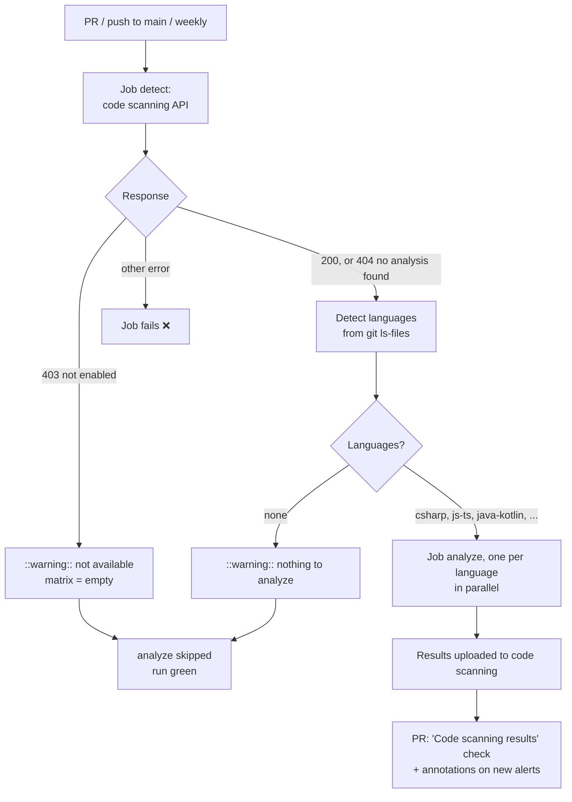

# CodeQL

Workflow that runs [CodeQL](https://codeql.github.com/), GitHub's static analysis, to find
security bugs in the code: injection (SQL, command, LDAP), XSS, unsafe deserialization, path
traversal, hardcoded credentials, weak crypto, and more. It also analyzes the repo's GitHub
Actions workflows (script injection, excessive permissions). Results appear as code scanning
alerts in the **Security** tab and as annotations on the PR.

- Workflow: [`.github/workflows/codeql.yml`](../.github/workflows/codeql.yml)
- Caller sample (call mode): [`examples/codeql.yml`](../examples/codeql.yml)
- Action: `github/codeql-action` v4.39.1, pinned by commit SHA
- Repo access: `contents: read`, `security-events: write`, `actions: read`

---

## Requirements

| Repo | Works? |
|------|--------|
| Public | Yes, free. |
| Private, with GitHub Code Security / Advanced Security | Yes. |
| Private, without it | No. The `detect` job leaves a warning and skips the analysis, and the run stays green. |

This isn't only a technical limit: CodeQL's license doesn't allow analyzing private code
without a GitHub Code Security / Advanced Security license. Skipping is the right behavior.

If the repo has CodeQL **default setup** enabled (Settings → Code security → Code scanning),
turn it off before adding this workflow: GitHub rejects results from a workflow
("advanced setup") while default setup is on.

---

## Coverage by stack

| Stack | CodeQL language | Build mode | Notes |
|---|---|---|---|
| .NET (C#) | `csharp` | `none` | No build needed. F# and VB aren't analyzed. |
| Node / TypeScript, React, Angular | `javascript-typescript` | `none` | Also covers `.vue` files. |
| Android (Kotlin) | `java-kotlin` | `autobuild` | Kotlin can't be analyzed without a build, so CodeQL runs the Gradle wrapper. See [Android](#android-kotlin). |
| Java only | `java-kotlin` | `none` | Switches to `autobuild` as soon as there's a `.kt` file. |
| Flutter / Dart | — | — | CodeQL doesn't support Dart. The generated `android/` folder of a Flutter app is ignored. |
| Python | `python` | `none` | |
| GitHub Actions | `actions` | `none` | Always detected (the repo has workflows). |
| Docker, Bicep, Terraform | — | — | Not covered by CodeQL. |

`go` and `ruby` work too if set by hand in `LANGUAGES`. C/C++ and Swift aren't supported by this
workflow (they need a manual build, or a macOS runner).

---

## Usage

The same file supports two modes. Pick one per repo.

| | A) Copy (main use) | B) Call |
|---|---|---|
| Works for | Any repo, any organization | Repos of the same owner as `rubone/shared-workflows` (or any repo, if this one is public) |
| What goes in the project repo | The whole `codeql.yml` | A short caller ([example](../examples/codeql.yml)) |
| Where values go | Top-level `env:` of the copied file | `with:` inputs in the caller |
| Trigger | `on:` in the copied file | `on:` in the caller |

### A) Copy

1. Copy [`.github/workflows/codeql.yml`](../.github/workflows/codeql.yml) unchanged to
   `.github/workflows/` in the target repo.
2. If the default branch isn't `main`, change `on.pull_request.branches` and `on.push.branches`.
3. Usually nothing else: languages are detected from the files.

No secrets are needed.

### B) Call

```yaml
name: CodeQL

on:
  pull_request:
    branches: [main]
  push:
    branches: [main]
  schedule:
    - cron: '27 4 * * 1'

permissions: {}

jobs:
  codeql:
    permissions:
      contents: read
      security-events: write
      actions: read
    uses: rubone/shared-workflows/.github/workflows/codeql.yml@v1
```

The calling job **must grant** the three permissions. Without `security-events`, the run fails
at startup with *"The nested job 'detect' is requesting 'security-events: read', but is only
allowed 'none'"*.

---

## Values

| `env` (copy) | Input (call) | Default | Description |
|---|---|---|---|
| `LANGUAGES` | `languages` | `''` | CodeQL languages, comma-separated (`actions`, `csharp`, `go`, `java-kotlin`, `javascript-typescript`, `python`, `ruby`). Empty = detect from the files. Set it to analyze fewer languages or to add `go`/`ruby`. |
| `QUERIES` | `queries` | `''` | Query suite. Empty = `default` (high precision, few false positives). `security-extended` adds more security queries with more noise. `security-and-quality` also adds maintainability queries. |
| `JAVA_BUILD_MODE` | `java_build_mode` | `''` | Build mode for `java-kotlin`. Empty = `autobuild` if there are `.kt` files, else `none`. |

Outputs: none.

### How languages are detected

From the files tracked in git (`git ls-files`):

| Language | Files |
|---|---|
| `csharp` | `*.cs`, `*.csproj` |
| `javascript-typescript` | `*.js`, `*.jsx`, `*.mjs`, `*.cjs`, `*.ts`, `*.tsx`, `*.mts`, `*.cts`, `*.vue` |
| `java-kotlin` | `*.java`, `*.kt` (excluding `android/` when there's a `pubspec.yaml` at the root) |
| `python` | `*.py` |
| `actions` | `.github/workflows/*.yml`, `*.yaml` |

A .NET project with JavaScript in `wwwroot/` gets both `csharp` and `javascript-typescript`.
That's intended: that JavaScript runs in the browser and can have XSS.

---

## How it works



- **The analysis job doesn't fail on findings.** It uploads results. Code scanning then adds its
  own **Code scanning results / CodeQL** check to the PR, which fails when the PR introduces
  alerts with severity `error`, or security severity `critical` or `high`. The threshold can be
  changed in the repo's code scanning settings
  ([docs](https://docs.github.com/en/code-security/how-tos/find-and-fix-code-vulnerabilities/manage-your-configuration/edit-default-setup#defining-the-alert-severities-that-cause-a-check-failure-for-a-pull-request)).
  Make that check required in a ruleset to block the merge.
- **Only new alerts block a PR.** Alerts already on `main` show in the Security tab, not on PRs.
- **The weekly run** catches new queries added to CodeQL, even when the code didn't change.
- **`actions: read`** is needed only in private repos; it's harmless in public ones.

---

## Android (Kotlin)

With `autobuild`, CodeQL runs `./gradlew` to compile the app, using the Android SDK and the
default JDK that come with the `ubuntu-latest` runner. If the build fails:

- **Wrong JDK:** set `JAVA_HOME` before the analysis (add `actions/setup-java` in a copy of the
  workflow), or move the analysis into the project's own Android CI.
- **Private dependencies or secrets needed to build:** autobuild can't provide them. Use
  `JAVA_BUILD_MODE: 'none'` to analyze only the Java code (Kotlin is skipped with a warning), or
  build manually in your CI.
- **Slow:** a full Gradle build per PR. The job has a 120-minute timeout.

---

## Verify

1. Merge the workflow (or the caller) to `main` of a public repo, or a private one with Code
   Security.
2. Open a PR that adds an obvious issue. For example, in a Node project:

   ```js
   // src/vuln.js
   const { exec } = require('child_process');
   const http = require('http');
   http.createServer((req, res) => {
     exec('ls ' + new URL(req.url, 'http://x').searchParams.get('dir'));
     res.end();
   }).listen(3000);
   ```

3. The **Analyze (javascript-typescript)** job passes, and a few seconds later the
   **Code scanning results / CodeQL** check fails with an *"Uncontrolled command line"* alert on
   the `exec` line.
4. Close the PR without merging.

---

## Troubleshooting

| Symptom | Cause | Fix |
|---------|-------|-----|
| Warning `Code scanning is not available for …`, analysis skipped | Private repo without Code Security / Advanced Security | Enable it, or accept the skip |
| `detect` fails with `Code scanning API call failed: … not authorized` | Call mode: the caller didn't grant `security-events` | Add the three permissions to the calling job |
| Upload fails: `CodeQL analyses from advanced configurations cannot be processed when the default setup is enabled` | CodeQL default setup is on | Settings → Code security → Code scanning → CodeQL → **Disable** |
| `Detected X Kotlin files … could not be processed without a build` | `JAVA_BUILD_MODE` is `none` with Kotlin files | Leave it empty (auto) or set `autobuild` |
| `We were unable to automatically build your code` (Android) | Gradle build failed | See [Android](#android-kotlin) |
| `Language 'dart' isn't supported by this workflow` | `LANGUAGES` has a language CodeQL or this workflow doesn't support | Remove it |
| Many alerts from third-party JS in `wwwroot/lib` | Vendored libraries are analyzed | Add a CodeQL config with `paths-ignore` (see extensions) |
| No **Code scanning results** check on the PR | First analysis on `main` hasn't finished yet | Wait for the push run on `main`, then open the PR again |

## Possible extensions

- `config-file` input with a shared CodeQL config (`paths-ignore`, extra query packs).
- Manual build mode (`build_command` input) for projects autobuild can't compile.
- `setup-java` / `setup-dotnet` steps with version inputs.
