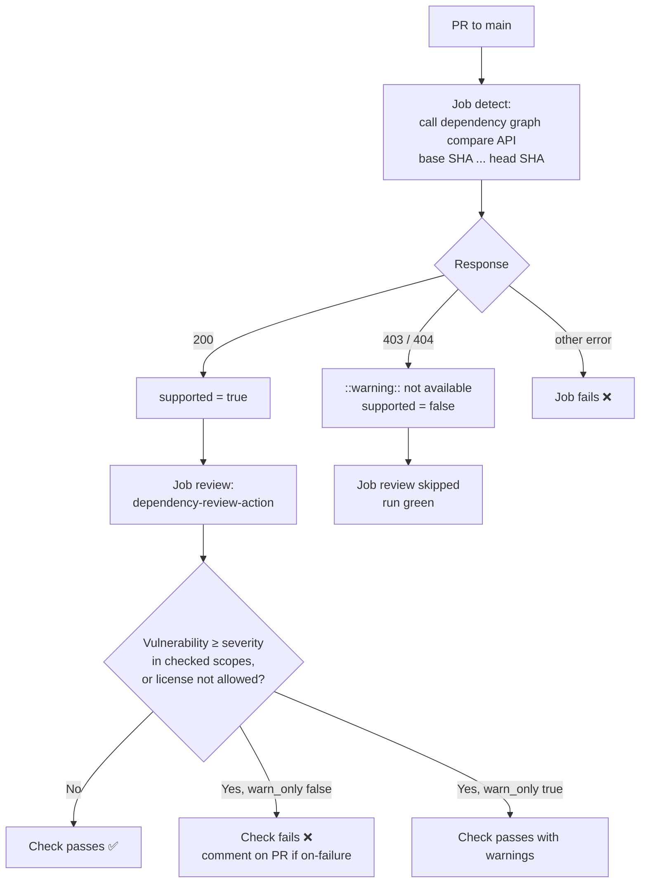

# Dependency review

Workflow that checks the dependencies a pull request adds or changes and fails the PR when one
has a known vulnerability at or above a chosen severity. It can also enforce a license allow
list. It reads GitHub's dependency graph through
[`actions/dependency-review-action`](https://github.com/actions/dependency-review-action), so it
doesn't build the project. It only sees what the dependency graph can read: coverage depends on
the stack (see [Coverage by stack](#coverage-by-stack)).

- Workflow: [`.github/workflows/dependency-review.yml`](../.github/workflows/dependency-review.yml)
- Caller sample (call mode): [`examples/dependency-review.yml`](../examples/dependency-review.yml)
- Action: `actions/dependency-review-action` v5.0.0, pinned by commit SHA
- Repo access: `contents: read`, plus `pull-requests: write` for the PR comment. No checkout.

---

## Requirements

| Repo | Works? |
|------|--------|
| Public | Yes, free. |
| Private, with GitHub Advanced Security / Code Security | Yes. |
| Private, without it | No. The `detect` job leaves a warning and skips the review, and the run stays green. |

The dependency graph must be enabled: **Settings → Code security → Dependency graph**. It is on
by default for public repos.

---

## Coverage by stack

The dependency graph reads some manifests by itself (static parsing). Others need a build step
that sends the resolved dependencies to GitHub (*dependency submission*). Source:
[Dependency graph supported package ecosystems](https://docs.github.com/en/code-security/reference/supply-chain-security/dependency-graph-supported-package-ecosystems).

| Stack | Files read | Coverage | To improve it |
|---|---|---|---|
| Node / TypeScript, React, Angular | `package-lock.json`, `yarn.lock`, `pnpm-lock.yaml` (+ `package.json`) | ✅ Direct and transitive | Commit the lockfile. pnpm 12's two-document `pnpm-lock.yaml` isn't detected. |
| .NET (NuGet) | `.csproj`, `.fsproj`, `.vbproj`, `.nuspec`, `packages.config` | ⚠️ Direct only | Transitive dependencies need dependency submission: turn on **Settings → Code security → Automatic dependency submission**. |
| Android (Gradle) | — | ❌ Nothing by static parsing | Dependency submission is required: automatic (setting above) or [`gradle/actions/dependency-submission`](https://github.com/gradle/actions) in the CI. Planned for `android-ci`. |
| Java (Maven) | `pom.xml` | ✅ Direct and transitive | — |
| Flutter / Dart (pub) | `pubspec.lock` (+ `pubspec.yaml`) | ⚠️ Read, but few advisories exist for pub | Little to gain; keep the lockfile committed. |
| GitHub Actions | `uses:` in `.github/workflows/*.yml` | ✅ Actions and reusable workflows | — |
| Docker images | — | ❌ Not covered | Use an image scanner (`trivy-scan`, planned). |
| Infrastructure (Bicep, Terraform) | — | ❌ Not covered | Out of scope. |

With dependency submission, the review compares the snapshots submitted for the PR's base and
head. If the PR's snapshot isn't there yet when the review runs, the action warns that the
results may be incomplete; the action's `retry-on-snapshot-warnings` option waits for it.

---

## Usage

The same file supports two modes. Pick one per repo.

| | A) Copy (main use) | B) Call |
|---|---|---|
| Works for | Any repo, any organization | Any repo, any organization whose Actions policy allows workflows from `rubone/shared-workflows` |
| What goes in the project repo | The whole `dependency-review.yml` | A short caller ([example](../examples/dependency-review.yml)) |
| Where values go | Top-level `env:` of the copied file | `with:` inputs in the caller |
| Trigger | `on.pull_request` in the copied file | `on:` in the caller |

### A) Copy

1. Copy [`.github/workflows/dependency-review.yml`](../.github/workflows/dependency-review.yml)
   unchanged to `.github/workflows/` in the target repo.
2. If the defaults don't fit, edit the top-level `env:` block (see [Values](#values)).
3. If the default branch isn't `main`, change `on.pull_request.branches`.

No secrets are needed: it uses the workflow's own `GITHUB_TOKEN`.

### B) Call

```yaml
name: Dependency review

on:
  pull_request:
    branches: [main]

permissions: {}

jobs:
  dependency-review:
    permissions:
      contents: read
      pull-requests: write
    uses: rubone/shared-workflows/.github/workflows/dependency-review.yml@v1
    with:
      fail_on_severity: 'high'
```

The calling job **must grant** `contents: read` and `pull-requests: write`. A reusable
workflow's jobs can't get more permissions than the caller gives, and the run fails at startup
with *"The nested job 'review' is requesting 'pull-requests: write', but is only allowed
'none'"*. If you set `comment_summary: 'never'`, `contents: read` is enough.

---

## Values

Each value lives in the top-level `env:` (copy mode). In call mode, the matching input overrides
it. An empty input falls back to the `env` value.

| `env` (copy) | Input (call) | Default | Description |
|---|---|---|---|
| `FAIL_ON_SEVERITY` | `fail_on_severity` | `moderate` | Lowest vulnerability severity that fails the PR: `low`, `moderate`, `high`, `critical`. |
| `FAIL_ON_SCOPES` | `fail_on_scopes` | `runtime` | Dependency scopes to check, comma-separated: `runtime`, `development`, `unknown`. With `runtime`, devDependencies don't block. |
| `ALLOW_LICENSES` | `allow_licenses` | `''` | SPDX licenses allowed, comma-separated (e.g. `MIT, Apache-2.0, BSD-3-Clause`). A new dependency with any other license fails the PR. Empty = no license check. |
| `ALLOW_GHSAS` | `allow_ghsas` | `''` | GitHub Advisory IDs to ignore, comma-separated (e.g. `GHSA-xxxx-xxxx-xxxx`). For accepted risks; leave a comment saying why. |
| `COMMENT_SUMMARY` | `comment_summary` | `on-failure` | Post the summary as a PR comment: `always`, `on-failure`, `never`. The summary is always in the run's job summary. |
| `WARN_ONLY` | `warn_only` (boolean) | `false` | `true` = report findings but never fail. Useful while adopting the check in a repo with existing issues. |

Outputs: none.

---

## How it works



- **`detect`** asks the dependency graph API for the diff between the PR's base and head. A
  `403` or `404` means the feature isn't available for this repo (private without Advanced
  Security, or dependency graph off), so it warns and skips. Any other error fails the job, so
  an API outage doesn't silently pass a security check.
- **`review`** runs the official action with the configured values. It only looks at
  dependencies the PR changes, not the whole tree.

---

## Verify

1. Merge the workflow (or the caller) to the project's `main`.
2. Open a PR that adds a dependency with a known vulnerability, for example in a Node project:
   `npm install lodash@4.17.20` (affected by GHSA-35jh-r3h4-6jhm, high).
3. The **Dependency review** check fails, and the PR gets a comment listing the advisory.
4. Close the PR without merging.

A PR that changes no dependency files passes with *"No dependency changes found"*.

---

## Troubleshooting

| Symptom | Cause | Fix |
|---------|-------|-----|
| Warning `Dependency review is not available for …`, review skipped | Private repo without Advanced Security, or dependency graph disabled | Enable the dependency graph, or Advanced Security / Code Security for private repos |
| Run fails at startup: `nested job … is requesting 'pull-requests: write', but is only allowed 'none'` | Call mode: the caller didn't grant permissions | Add `permissions: { contents: read, pull-requests: write }` to the calling job |
| `detect` fails with `Dependency graph API call failed` | GitHub API error other than 403/404 | Re-run the job; check [githubstatus.com](https://www.githubstatus.com) |
| Doesn't flag a known-vulnerable package in an Android or .NET project | The dependency graph doesn't see it (Gradle) or sees only direct dependencies (NuGet) | See [Coverage by stack](#coverage-by-stack) |
| Fails on a dev-only package | `FAIL_ON_SCOPES` includes `development` | Set it to `runtime` |
| Fails on a vulnerability with no fix yet | Severity at or above `FAIL_ON_SEVERITY` | Add the advisory to `ALLOW_GHSAS` with a reason, or raise the severity |
| Fails with `Invalid license(s) in allow-licenses` | A name that isn't an SPDX ID (e.g. `Apache 2`) | Use SPDX IDs: `Apache-2.0`, `MIT`, `BSD-3-Clause` |
| No PR comment | `COMMENT_SUMMARY` is `never`, or `on-failure` and the check passed; or fork PR with a read-only token | Expected; the job summary always has the report |
| Warning `Dependency review only runs on pull_request events` | Triggered by another event (push, schedule) | Use it only with `pull_request` |

## Possible extensions

- `deny-packages` / `deny-groups` to block specific packages.
- Input for `retry-on-snapshot-warnings`, for repos that use dependency submission.
- `show-openssf-scorecard` to add OpenSSF Scorecard scores to the summary.
- A shared `config-file` in this repo, so every project reads the same policy.
