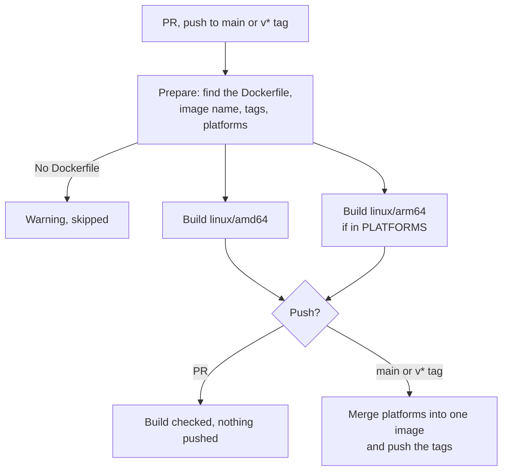

# Docker build and push

Workflow that builds a Docker image with Buildx and pushes it to GitHub Container Registry
(GHCR) or Azure Container Registry (ACR).

| Event | What it does | Tags |
|---|---|---|
| Pull request | Builds the image to check the Dockerfile. **Nothing is pushed.** | — |
| Push to `main` | Builds and pushes | `sha-1a2b3c4`, `main` |
| Tag `v1.2.3` | Builds and pushes | `1.2.3`, `1.2`, `1`, `latest`, `sha-1a2b3c4` |

The Buildx layer cache is kept between runs, so a build that only changes the app code reuses
the dependency layers.

- Workflow: [`.github/workflows/docker-build-push.yml`](../.github/workflows/docker-build-push.yml)
- Caller sample (call mode): [`examples/docker-build-push.yml`](../examples/docker-build-push.yml)
- Actions: `docker/setup-buildx-action` v4.4.1, `docker/metadata-action` v6.2.0,
  `docker/build-push-action` v7.4.0, `docker/login-action` v4.7.0, `docker/setup-qemu-action`
  v4.4.0, `azure/login` v3.1.0 (ACR only), `actions/upload-artifact` v7.0.2 and
  `actions/download-artifact` v8.0.2, pinned by commit SHA
- Repo access: `contents: read`, `packages: write` (GHCR), `id-token: write` (ACR). No secrets.

---

## Requirements

A `Dockerfile` in `CONTEXT` (or at `DOCKERFILE`). Without one, the workflow skips with a
warning and the run stays green.

- **GHCR:** nothing to set up. The workflow signs in with `GITHUB_TOKEN`.
- **ACR:** a registry, and an identity that can push to it from GitHub with OIDC (see
  [ACR setup](#acr-setup)). No passwords stored in GitHub.

---

## Usage

The same file supports two modes. Pick one per repo.

| | A) Copy (main use) | B) Call |
|---|---|---|
| Works for | Any repo, any organization | Any repo, any organization whose Actions policy allows workflows from `rubone/shared-workflows` |
| What goes in the project repo | The whole `docker-build-push.yml` | A short caller ([example](../examples/docker-build-push.yml)) |
| Where values go | Top-level `env:` of the copied file | `with:` inputs in the caller |
| Trigger | `on:` in the copied file (PRs, pushes to `main`, `v*` tags) | `on:` in the caller |

### A) Copy

1. Copy [`.github/workflows/docker-build-push.yml`](../.github/workflows/docker-build-push.yml)
   to `.github/workflows/` in the target repo.
2. If the Dockerfile isn't at the root, set `CONTEXT` (and `DOCKERFILE` if it has another
   name). For ACR, set `REGISTRY: 'acr'` and `ACR_NAME`.
3. If the default branch isn't `main`, change `on.pull_request.branches` and
   `on.push.branches`.

### B) Call

```yaml
name: Docker build and push

on:
  pull_request:
    branches: [main]
  push:
    branches: [main]
    tags: ['v*']

permissions: {}

jobs:
  docker:
    permissions:
      contents: read
      packages: write
      id-token: write
    uses: rubone/shared-workflows/.github/workflows/docker-build-push.yml@v1
```

The calling job must grant `packages: write` and `id-token: write`, even with GHCR (which
doesn't use `id-token`): GitHub rejects the whole workflow if a nested job asks for more than
the caller grants.

**Using the image in a later job:** the workflow's outputs `image`, `digest` and `tags` are set
when it pushes (empty on PRs). Deploy by digest, which never changes, rather than by tag:

```yaml
  deploy:
    needs: docker
    if: needs.docker.outputs.digest != ''
    runs-on: ubuntu-latest
    steps:
      - run: echo "Deploying ${{ needs.docker.outputs.image }}@${{ needs.docker.outputs.digest }}"
```

**Several images in one repo** (e.g. `api/` and `worker/`): call it once per image with a
matrix, setting `context` and `image_name`.

---

## Values

| `env` (copy) | Input (call) | Default | Description |
|---|---|---|---|
| `CONTEXT` | `context` | `.` | Build context folder, relative to the repo root. |
| `DOCKERFILE` | `dockerfile` | `''` | Dockerfile path, relative to the repo root. Empty = `<CONTEXT>/Dockerfile`. |
| `REGISTRY` | `registry` | `ghcr` | `ghcr` or `acr`. |
| `IMAGE_NAME` | `image_name` | `''` | Image name. Empty = the repo name. In GHCR, a name without `/` goes under the repo owner. |
| `PLATFORMS` | `platforms` | `linux/amd64` | Comma-separated platforms, e.g. `linux/amd64,linux/arm64`. |
| `BUILD_ARGS` | `build_args` | `''` | Build arguments, one `KEY=value` per line. Not for secrets: they stay in the image history. |
| `TARGET` | `target` | `''` | Dockerfile stage to build. Empty = the last one. |
| `PUSH` | `push` | `auto` | `auto` = push on the default branch and `v*` tags; `false` = never push. |
| `ARM_RUNNER` | `arm_runner` | `auto` | Runner for `linux/arm64`: `auto`, `qemu` or a runner label (see [Platforms](#platforms)). |
| `ACR_NAME` | `acr_name` | `''` | ACR only: registry name, without `.azurecr.io`. |
| `AZURE_CLIENT_ID` | `azure_client_id` | `vars.AZURE_CLIENT_ID` | ACR only: client ID of the identity with the federated credential. |
| `AZURE_TENANT_ID` | `azure_tenant_id` | `vars.AZURE_TENANT_ID` | ACR only: Entra tenant ID. |
| `AZURE_SUBSCRIPTION_ID` | `azure_subscription_id` | `vars.AZURE_SUBSCRIPTION_ID` | ACR only: subscription ID. |

In call mode, an empty input falls back to the `env` value. The `AZURE_*` values are IDs, not
secrets: keep them as repository variables (**Settings → Secrets and variables → Actions →
Variables**) and pass them from the caller as in the [example](../examples/docker-build-push.yml).

Outputs (call mode): `image` (`ghcr.io/org/app`), `digest` (`sha256:…`) and `tags`
(comma-separated, full references).

### Image names

| `REGISTRY` | `IMAGE_NAME` | Image |
|---|---|---|
| `ghcr` | empty | `ghcr.io/<owner>/<repo>` |
| `ghcr` | `api` | `ghcr.io/<owner>/api` |
| `acr` | empty | `<acr>.azurecr.io/<repo>` |
| `acr` | `team/api` | `<acr>.azurecr.io/team/api` |

Names are lowercased: registries require it.

### Tags

- **`sha-<7 chars>`** on every push: points to an exact commit. Use it (or the digest) to
  deploy.
- **The branch name** (`main`): always the latest build of that branch.
- **Semver** on `v*` tags: `v1.2.3` gives `1.2.3`, `1.2`, `1` and `latest`. `v0.x` tags don't
  get the major-only tag (`0`), since `0.x` releases aren't compatible with each other.
- **`latest`** only on release tags, so it never points to an unreleased build.

### Platforms

With one platform (the default, `linux/amd64`), one job builds and pushes the image.

With several, each platform builds in its own job, in parallel, and a last job merges them
into one multi-platform image under the same tags. Docker then pulls the right one for each
machine.

| Platform | Runner |
|---|---|
| `linux/amd64` | `ubuntu-latest` |
| `linux/arm64`, public repo | `ubuntu-24.04-arm`, a native ARM runner: as fast as amd64 |
| `linux/arm64`, private repo | `ubuntu-latest` with QEMU emulation: works, but builds take several times longer |
| Others (`linux/arm/v7`…) | `ubuntu-latest` with QEMU |

`ARM_RUNNER` overrides the choice: `qemu` to always emulate, or a runner label (a larger ARM
runner, a self-hosted one) for private repos where emulation is too slow.

Azure App Service and Container Apps run on amd64: add arm64 only if something runs the image
on ARM (Apple Silicon Macs, AWS Graviton, a Raspberry Pi).

### Cache

Layers are cached in GitHub's Actions cache (`type=gha`, `mode=max`), one scope per context
and platform. PRs read the cache from `main` and write their own. The cache counts toward the
repo's 10 GB Actions cache limit; GitHub evicts the oldest entries.

### SBOM and provenance

Pushed images carry two attestations, built by BuildKit: a **provenance** record (how and
where it was built) and an **SBOM** (the packages inside). Tools like Docker Scout and Trivy
read them. GHCR lists them as extra entries with platform `unknown/unknown`: that's expected.

To scan the image for known vulnerabilities on every PR, after each push and weekly, add
[trivy-scan](trivy-scan.md).

---

## GHCR notes

- The first push creates the package, linked to the repo through the
  `org.opencontainers.image.source` annotation. Check its visibility on the package page
  (repo → **Packages**); to change it: **Package settings → Change visibility**.
- Pulling a private image from outside GitHub (an Azure Web App, a server) needs a token with
  `read:packages`.
- If the package already exists and was created by another repo or by hand, the push fails
  with `permission_denied: write_package`. Give the repo access in **Package settings → Manage
  Actions access** (role: Write).

## ACR setup

The workflow signs in to Azure with OpenID Connect: GitHub issues a short-lived token for each
run, and Azure trusts it through a federated credential. Once:

1. Create a **user-assigned managed identity** (or an Entra app registration).
2. On the registry, give it the **AcrPush** role (**Access control (IAM) → Add role
   assignment**).
3. On the identity, add a **federated credential** for GitHub Actions: organization, repo,
   entity **Branch**, branch `main`.
4. In the GitHub repo, add the variables `AZURE_CLIENT_ID` (the identity's client ID),
   `AZURE_TENANT_ID` and `AZURE_SUBSCRIPTION_ID`.

Pushes from `v*` tags present a different identity to Azure (`ref:refs/tags/v1.2.3`), and a
standard federated credential only matches one exact branch or tag. To push releases to ACR
too, add a flexible federated credential that matches `repo:<owner>/<repo>:ref:refs/tags/v*`,
or push to ACR from `main` only.

PRs don't sign in to Azure: they only build.

---

## How it works



A new push to the same PR cancels the build in progress.

---

## Verify

1. Merge the workflow to `main` (copy mode), or add the caller.
2. Open a PR that touches the Dockerfile: the **Build linux/amd64** job builds it and the
   summary says *not pushed*.
3. After merging, the push to `main` runs **Push image**. Its summary lists the tags and the
   digest, and the image shows under the repo's **Packages** (GHCR).
4. Pull it: `docker pull ghcr.io/<owner>/<repo>:main`.

To require the build before merging, add **Build linux/amd64** (copy mode) or **docker /
Build linux/amd64** (call mode, if the caller's job is called `docker`) to the required status
checks in **Settings → Rules → Rulesets**.

---

## Troubleshooting

| Symptom | Cause | Fix |
|---|---|---|
| Warning `No Dockerfile at './Dockerfile'` | The Dockerfile is in a subfolder or has another name | Set `CONTEXT` and/or `DOCKERFILE` |
| `The workflow is not valid … requesting 'packages: write'` (or `id-token`) | Call mode: the caller doesn't grant it | Grant `packages: write` and `id-token: write` to the calling job |
| `denied: permission_denied: write_package` | The GHCR package belongs to another repo | **Package settings → Manage Actions access**: add this repo with Write |
| `AADSTS700213: No matching federated identity record found` | The federated credential doesn't match this branch or tag | Check the credential's branch, or add one for `v*` tags (see [ACR setup](#acr-setup)) |
| `unauthorized` / `403` pushing to ACR | The identity has no AcrPush role | Add the role assignment on the registry |
| `exec format error` during the arm64 build | A `RUN` step runs an amd64-only binary | Use a multi-platform base image, or download the binary for `$TARGETARCH` |
| arm64 build takes very long | QEMU emulation (private repo) | Use an ARM runner label in `ARM_RUNNER`, or drop arm64 |
| arm64 job stays queued | `ARM_RUNNER` names a runner the repo can't use | Set `ARM_RUNNER: 'qemu'` or a runner you have |
| `ERROR: failed to solve: … not found` for a `COPY` | The file isn't in the build context, or is excluded by `.dockerignore` | Check `CONTEXT` and `.dockerignore` |

## Possible extensions

- Build secrets (`--secret`) for private package feeds, from repository secrets.
- GitHub artifact attestations (`actions/attest-build-provenance`), verifiable with `gh
  attestation verify`. Free for public repos; private repos need GitHub Enterprise Cloud.
- Docker Hub as a third registry, with a username and token.
- Push on PRs with a `pr-<number>` tag, for preview environments.
