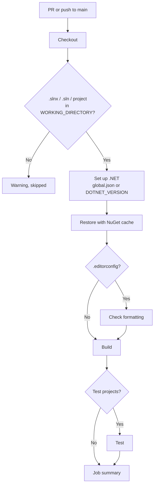

# .NET CI

Workflow that checks every PR and push of a .NET solution: ASP.NET Core APIs, workers, class
libraries. It runs:

| Step | Command | When |
|---|---|---|
| **Restore** | `dotnet restore` (with `--locked-mode` if there are `packages.lock.json` files) | Always |
| **Check formatting** | `dotnet format --verify-no-changes` | When there's an `.editorconfig` (`FORMAT_CHECK: 'auto'`) |
| **Build** | `dotnet build -c Release` (optionally `-warnaserror`) | Always |
| **Test** | `dotnet test` | When a project references xUnit, NUnit, MSTest or `Microsoft.NET.Test.Sdk` |

The NuGet packages are cached between runs.

- Workflow: [`.github/workflows/dotnet-ci.yml`](../.github/workflows/dotnet-ci.yml)
- Caller sample (call mode): [`examples/dotnet-ci.yml`](../examples/dotnet-ci.yml)
- Actions: `actions/setup-dotnet` v6.0.0 and `actions/cache` v6.1.0, pinned by commit SHA
- Repo access: `contents: read`. No secrets.

---

## Requirements

A `.slnx`, `.sln` or project file in `WORKING_DIRECTORY`. Without one, the workflow skips with
a warning and the run stays green.

Recommended, though not required:

- **`global.json`**, so CI uses the same SDK as your machine. `dotnet new globaljson
  --sdk-version 10.0.100 --roll-forward latestFeature` creates one that accepts any 10.0
  feature band.
- **`.editorconfig`**, to check formatting. `dotnet new editorconfig` creates one with the
  .NET defaults.

---

## What it detects

**Solution**, in `WORKING_DIRECTORY` (not in subfolders):

1. `SOLUTION`, if set.
2. The only `.slnx` or `.sln`. With more than one, the run fails and asks to set `SOLUTION`.
3. The only `.csproj` (or `.fsproj`), for repos without a solution.

**SDK version:** `global.json` in `WORKING_DIRECTORY` or the repo root. Without it,
`DOTNET_VERSION` (`10.0.x` = the latest .NET 10 SDK).

**Test runner:** VSTest by default. If `global.json` opts in to Microsoft.Testing.Platform
(`"test": { "runner": "Microsoft.Testing.Platform" }`), the test step uses its syntax
(`dotnet test --solution …`), and the job summary doesn't show test totals.

---

## Usage

The same file supports two modes. Pick one per repo.

| | A) Copy (main use) | B) Call |
|---|---|---|
| Works for | Any repo, any organization | Any repo, any organization whose Actions policy allows workflows from `rubone/shared-workflows` |
| What goes in the project repo | The whole `dotnet-ci.yml` | A short caller ([example](../examples/dotnet-ci.yml)) |
| Where values go | Top-level `env:` of the copied file | `with:` inputs in the caller |
| Trigger | `on:` in the copied file (PRs and pushes to `main`) | `on:` in the caller |

### A) Copy

1. Copy [`.github/workflows/dotnet-ci.yml`](../.github/workflows/dotnet-ci.yml) to
   `.github/workflows/` in the target repo.
2. If the solution isn't at the root, set `WORKING_DIRECTORY`.
3. If the default branch isn't `main`, change `on.pull_request.branches` and
   `on.push.branches`.

### B) Call

```yaml
name: .NET CI

on:
  pull_request:
    branches: [main]
  push:
    branches: [main]

permissions: {}

jobs:
  dotnet-ci:
    permissions:
      contents: read
    uses: rubone/shared-workflows/.github/workflows/dotnet-ci.yml@v1
```

**Repo with a .NET backend and a Node frontend:** use both workflows, each with its folder.

```yaml
jobs:
  backend:
    permissions:
      contents: read
    uses: rubone/shared-workflows/.github/workflows/dotnet-ci.yml@v1
    with:
      working_directory: backend
  frontend:
    permissions:
      contents: read
    uses: rubone/shared-workflows/.github/workflows/node-ci.yml@v1
    with:
      working_directory: frontend
```

---

## Values

| `env` (copy) | Input (call) | Default | Description |
|---|---|---|---|
| `WORKING_DIRECTORY` | `working_directory` | `.` | Folder with the solution, relative to the repo root. |
| `SOLUTION` | `solution` | `''` | Solution or project file, relative to `WORKING_DIRECTORY`. Empty = detect. |
| `DOTNET_VERSION` | `dotnet_version` | `10.0.x` | SDK version when there's no `global.json`. |
| `CONFIGURATION` | `configuration` | `Release` | Build configuration for build and test. |
| `FORMAT_CHECK` | `format_check` | `auto` | `auto` = when there's an `.editorconfig`; `true`; `false`. |
| `WARNINGS_AS_ERRORS` | `warnings_as_errors` (boolean) | `false` | `true` = build warnings fail the build. |

In call mode, an empty input (or `false` for the boolean) falls back to the `env` value.

Outputs: none. The job summary shows the SDK, each step's result and the test totals.

### Formatting

`dotnet format --verify-no-changes` checks whitespace, code style and analyzer rules against
the `.editorconfig`, without changing files. When it fails, the log lists each file and rule.
To fix it:

```bash
dotnet format          # applies the fixes
git commit -am "style: apply dotnet format"
```

It only reports rules with severity `warning` or `error` in the `.editorconfig`. Rules set to
`suggestion` or `silent` aren't checked.

### Warnings as errors

With `WARNINGS_AS_ERRORS: 'true'`, any build warning fails the run: nullable references
(`CS8602`…), obsolete APIs, analyzers. It's a good default for new projects. In an existing
project, fix the warnings first, or the first PR will fail.

Vulnerable packages: since .NET 8, `dotnet restore` warns about NuGet packages with known
vulnerabilities (`NU1901`–`NU1904`). Those warnings show up in the Restore step, which doesn't
use `-warnaserror`. To fail on them, set `<WarningsAsErrors>NU1903;NU1904</WarningsAsErrors>`
in `Directory.Build.props`, or rely on [dependency-review](dependency-review.md) for PRs.

### Faster, reproducible restores

With `<RestorePackagesWithLockFile>true</RestorePackagesWithLockFile>` (for example in
`Directory.Build.props`), `dotnet restore` writes a `packages.lock.json` per project. Commit
them: the workflow detects them and restores in locked mode, which fails if a package
changed without updating the lock file.

---

## How it works



Steps stop at the first failure: a formatting error doesn't wait for the build. A new push to
the same PR cancels the run in progress.

---

## Verify

1. Merge the workflow to `main` (copy mode), or add the caller.
2. Open a PR. The **Detect project** step of **.NET build and test** shows the solution, the SDK
   and what will run. The job summary shows each step's result and the test totals.
3. To see it fail, break a test: the **Test** step fails and the log shows which one.

To require it before merging, add **.NET build and test** (copy mode) or **dotnet-ci / .NET
build and test** (call mode, if the caller's job is called `dotnet-ci`) to the required
status checks in **Settings → Rules → Rulesets**.

---

## Troubleshooting

| Symptom | Cause | Fix |
|---|---|---|
| Warning `No .slnx, .sln or project file` | The solution is in a subfolder | Set `WORKING_DIRECTORY` |
| `More than one solution` | The folder has several `.sln`/`.slnx` | Set `SOLUTION` |
| `A compatible .NET SDK was not found` | `global.json` asks for an SDK that isn't released, or `rollForward` is too strict | Use `"rollForward": "latestFeature"` and an existing version |
| Check formatting fails | Code doesn't follow the `.editorconfig` | Run `dotnet format` locally and commit |
| Check formatting fails on files you didn't touch | The `.editorconfig` is new or changed | Run `dotnet format` once over the whole solution and commit it in its own PR |
| `NU1004` in Restore | Locked mode: `packages.lock.json` is out of date | Run `dotnet restore` locally and commit the lock files |
| Build fails with `warning … treated as error` | `WARNINGS_AS_ERRORS: 'true'` | Fix the warning, or turn it off |
| Notice `Test skipped: no test project` | No project references a test framework | Expected until there are tests |
| Tests that need a database fail | They expect SQL Server/Postgres running | Use Testcontainers (Docker is available on the runner) |

## Possible extensions

- Code coverage (coverlet, already in the xUnit template) with a summary in the job.
- Check for EF Core model changes without a migration (`dotnet ef migrations
  has-pending-model-changes`).
- Upload `dotnet publish` output as an artifact for later deploy jobs.
- Private NuGet feeds (GitHub Packages, Azure Artifacts) with a token secret.
