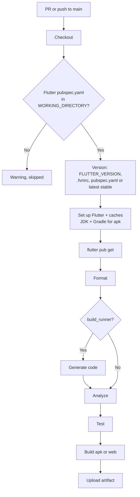

# Flutter CI

Workflow that checks every PR and push of a Flutter app or package. It runs:

| Step | Command | What it checks |
|---|---|---|
| **Format** | `dart format --output=none --set-exit-if-changed .` | The code is formatted as `dart format` would leave it |
| **Analyze** | `flutter analyze` | Errors, warnings and lints from `analysis_options.yaml` (infos included) |
| **Test** | `flutter test` | Unit and widget tests in `test/`, without an emulator |
| **Build** | `flutter build apk --debug` or `flutter build web` | The app compiles; the APK or web build is uploaded as an artifact |

Before analyzing, it installs the dependencies (with `pubspec.lock` enforced) and, when the
project uses `build_runner`, generates code.

- Workflow: [`.github/workflows/flutter-ci.yml`](../.github/workflows/flutter-ci.yml)
- Caller sample (call mode): [`examples/flutter-ci.yml`](../examples/flutter-ci.yml)
- Actions: `subosito/flutter-action` v2.23.0, plus `actions/setup-java` v6.1.0 and
  `gradle/actions/setup-gradle` v6.4.0 for the APK build, and `actions/upload-artifact`
  v7.0.2, pinned by commit SHA
- Repo access: `contents: read`. No secrets.

---

## Requirements

A `pubspec.yaml` that depends on the Flutter SDK (`dependencies: flutter: sdk: flutter`) in
`WORKING_DIRECTORY`. Without it, or for a pure Dart package, the workflow skips with a
warning and the run stays green.

Recommended, though not required:

- **Flutter pinned with [FVM](https://fvm.app/):** `fvm use 3.47.9` writes a `.fvmrc`, so CI
  uses the same Flutter as your machine. Without a pin, CI uses the latest stable, and a new
  Flutter release can break the build without any change in the repo.
- **`pubspec.lock` committed** (apps). CI then installs exactly those versions.

The Android SDK and Chrome come preinstalled on GitHub's Ubuntu runners.

---

## What it detects

**Flutter version**, first match wins:

1. `FLUTTER_VERSION`
2. `.fvmrc` (FVM 3) or `.fvm/fvm_config.json` (older FVM), in `WORKING_DIRECTORY` or a parent
   folder up to the repo root
3. `pubspec.yaml` → `environment.flutter`, only if it's an exact version (`3.47.9`). A range
   (`>=3.41.0`) doesn't pin anything.
4. The latest stable, with a notice suggesting to pin it

Versions can be exact (`3.47.9`), a prefix (`3.47`, `3.47.x`: the newest patch) or a channel
(`stable`, `beta`). Beta versions (`3.48.0-0.1.pre`) and FVM's `3.47.9@beta` form use the beta
channel.

**Dependencies:** with a `pubspec.lock`, `flutter pub get --enforce-lockfile`, which fails if
the lock file doesn't match `pubspec.yaml`. Without one, a notice and a plain `flutter pub get`
(normal for packages, which don't commit it).

**Code generation:** with `build_runner` in `dev_dependencies` (`CODEGEN: 'auto'`),
`dart run build_runner build --delete-conflicting-outputs` runs after the formatting check and
before analyze, so generated files (`*.g.dart`, `*.freezed.dart`) exist even if they aren't
committed.

**Build:** skipped with a notice for packages and plugins (no `lib/main.dart`, or a
`flutter: plugin:` section), and when the platform folder (`android/` for `apk`, `web/` for
`web`) doesn't exist. **Test:** skipped with a notice when `test/` has no `*_test.dart` files.

---

## Usage

The same file supports two modes. Pick one per repo.

| | A) Copy (main use) | B) Call |
|---|---|---|
| Works for | Any repo, any organization | Any repo, any organization whose Actions policy allows workflows from `rubone/shared-workflows` |
| What goes in the project repo | The whole `flutter-ci.yml` | A short caller ([example](../examples/flutter-ci.yml)) |
| Where values go | Top-level `env:` of the copied file | `with:` inputs in the caller |
| Trigger | `on:` in the copied file (PRs and pushes to `main`) | `on:` in the caller |

### A) Copy

1. Copy [`.github/workflows/flutter-ci.yml`](../.github/workflows/flutter-ci.yml) to
   `.github/workflows/` in the target repo.
2. If `pubspec.yaml` isn't at the root, set `WORKING_DIRECTORY`. For a web app, set
   `BUILD_TARGET: 'web'`.
3. If the default branch isn't `main`, change `on.pull_request.branches` and
   `on.push.branches`.

### B) Call

```yaml
name: Flutter CI

on:
  pull_request:
    branches: [main]
  push:
    branches: [main]

permissions: {}

jobs:
  flutter-ci:
    permissions:
      contents: read
    uses: rubone/shared-workflows/.github/workflows/flutter-ci.yml@v1
```

**App for Android and web:** build both with a matrix.

```yaml
jobs:
  flutter-ci:
    strategy:
      fail-fast: false
      matrix:
        build_target: [apk, web]
    permissions:
      contents: read
    uses: rubone/shared-workflows/.github/workflows/flutter-ci.yml@v1
    with:
      build_target: ${{ matrix.build_target }}
```

Both jobs run format, analyze and test too. To avoid that, set `steps: 'build'` in one of them.

---

## Values

| `env` (copy) | Input (call) | Default | Description |
|---|---|---|---|
| `WORKING_DIRECTORY` | `working_directory` | `.` | Folder with `pubspec.yaml`, relative to the repo root. |
| `FLUTTER_VERSION` | `flutter_version` | `''` | Flutter version or channel. Empty = detect (see above). |
| `STEPS` | `steps` | `format,analyze,test,build` | Steps to run, comma-separated. |
| `BUILD_TARGET` | `build_target` | `apk` | `apk` (debug APK) or `web` (release web build). |
| `CODEGEN` | `codegen` | `auto` | `auto` = when `build_runner` is a dependency; `true`; `false`. |
| `JAVA_VERSION` | `java_version` | `17` | JDK for the APK build. |
| `JAVA_DISTRIBUTION` | — | `temurin` | JDK distribution for `actions/setup-java`. |
| `ARTIFACT_RETENTION_DAYS` | `artifact_retention_days` (number) | `7` | Days to keep the APK or web build artifact (1–90). |
| `GRADLE_CACHE_PROVIDER` | — | `basic` | Gradle cache for the APK build: `basic` (MIT) or `enhanced` (proprietary). See [android-ci](android-ci.md#gradle-cache). |

In call mode, an empty input (or `0` for the number) falls back to the `env` value.

Outputs: none. The job summary shows the Flutter version, each step's result, the test totals
and the build size.

### Why JDK 17

Flutter's Android build runs Gradle, and the Gradle version depends on when the project was
created. JDK 17 works with every Gradle and Android Gradle plugin version Flutter's templates
have used since AGP 8. JDK 21 needs Gradle 8.5 or newer: set `JAVA_VERSION: '21'` only if
`android/gradle/wrapper/gradle-wrapper.properties` has 8.5+.

### Caches

- **Flutter SDK** and **pub packages** (`~/.pub-cache`, keyed on `pubspec.lock`): cached by
  `subosito/flutter-action`, from any branch.
- **Gradle** (APK build only): `setup-gradle`, written only on `main`; PR branches read it.

### Artifacts

- **APK:** `apk-<folder>`, `app-debug.apk`, signed with the default debug key: fine to install
  for testing, not to publish. A debug APK includes the engine for every CPU architecture and
  the Dart code in JIT mode, so it weighs 100–150 MB. In private repos, artifacts count
  toward the Actions storage quota: lower `ARTIFACT_RETENTION_DAYS` if it matters.
- **Web:** `web-<folder>`, the contents of `build/web/`, ready to serve from any static host.

---

## How it works



Steps stop at the first failure: a formatting error doesn't wait for the tests. A new push to
the same PR cancels the run in progress.

---

## Verify

1. Merge the workflow to `main` (copy mode), or add the caller.
2. Open a PR. The **Detect project** step of **Flutter build and test** shows the Flutter
   version and where it came from. The job summary lists each step, the test totals and the
   build.
3. Download the APK from the run's **Artifacts** and install it: `adb install app-debug.apk`.

To require it before merging, add **Flutter build and test** (copy mode) or **flutter-ci /
Flutter build and test** (call mode, if the caller's job is called `flutter-ci`) to the
required status checks in **Settings → Rules → Rulesets**.

---

## Troubleshooting

| Symptom | Cause | Fix |
|---|---|---|
| Warning `No pubspec.yaml in '.'` | The app is in a subfolder | Set `WORKING_DIRECTORY` |
| Warning `doesn't depend on the Flutter SDK` | A pure Dart package | Not supported by this workflow |
| Notice `No Flutter version pinned` | No FVM config and no exact `environment.flutter` | `fvm use <version>` and commit `.fvmrc`, or set `FLUTTER_VERSION` |
| `Unable to determine Flutter version` | The pinned version doesn't exist for that channel | Check the version in `.fvmrc`; beta versions need `@beta` or the `-x.y.pre` suffix |
| Format fails | Code isn't formatted | Run `dart format .` and commit |
| Format fails on generated files | Committed `*.g.dart` files are out of date or unformatted | Regenerate them with `build_runner`, or stop committing them (`CODEGEN` runs it in CI) |
| `--enforce-lockfile` fails | `pubspec.lock` is out of date | Run `flutter pub get` and commit `pubspec.lock` |
| Analyze fails on infos | `flutter analyze` treats infos as errors, like locally | Fix them, or set the rule's severity in `analysis_options.yaml` |
| Analyze fails with `Target of URI doesn't exist: '*.g.dart'` | Generated files are missing and `CODEGEN` is `false` | Set `CODEGEN: 'auto'` or commit them |
| APK build fails with `Unsupported class file major version` | JDK newer than the project's Gradle supports | Keep `JAVA_VERSION: '17'`, or update Gradle |
| `SDK location not found` / `flutter.sdk not set` | `android/local.properties` committed with your path | Remove it from git: Flutter writes it on each build |

## Possible extensions

- Code coverage (`flutter test --coverage`) with a summary in the job.
- iOS build without signing (`flutter build ios --no-codesign`) on a macOS runner.
- Release builds (AAB for Google Play) signed with a keystore from secrets.
- Integration tests on an emulator (`flutter test integration_test`), on larger runners.
- Pure Dart packages (`dart analyze`, `dart test`).
- Melos or pub workspaces with several packages.
