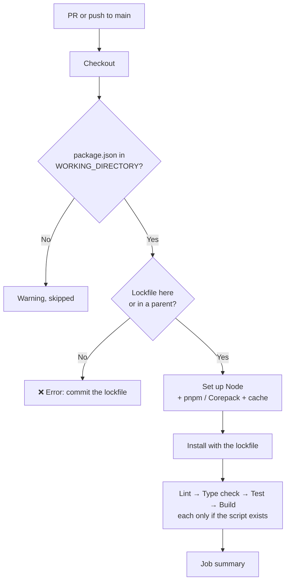

# Node CI

Workflow that checks every PR and push of a JavaScript/TypeScript project. It installs the
dependencies (with cache) and runs the project's own scripts:

| Step | Default scripts tried, in order | What it usually runs |
|---|---|---|
| **Lint** | `lint` | ESLint, `ng lint` |
| **Type check** | `typecheck`, `type-check` | `tsc --noEmit`, `vue-tsc --noEmit` |
| **Test** | `test:ci`, `test` | Jest, Vitest, Karma, `node --test` |
| **Build** | `build` | Vite, `ng build`, `next build`, `tsc` |

A step only runs if `package.json` has the script, so the same file fits React, Angular, Vue,
Next.js and Node backends (Express, NestJS…) without changes.

- Workflow: [`.github/workflows/node-ci.yml`](../.github/workflows/node-ci.yml)
- Caller sample (call mode): [`examples/node-ci.yml`](../examples/node-ci.yml)
- Actions: `actions/setup-node` v7.1.0 and `pnpm/action-setup` v6.1.0 (pnpm only), pinned
  by commit SHA
- Repo access: `contents: read`. No secrets.

---

## Requirements

- A `package.json` in `WORKING_DIRECTORY`. Without it, the workflow skips with a warning and
  the run stays green.
- A **committed lockfile**: `package-lock.json`, `pnpm-lock.yaml` or `yarn.lock`. Without it,
  the run fails: CI must install the same versions as your machine.

---

## What it detects

**Package manager**, from the lockfile:

| Lockfile | Package manager | Install | Cache |
|---|---|---|---|
| `package-lock.json` / `npm-shrinkwrap.json` | npm | `npm ci` | ✅ |
| `pnpm-lock.yaml` | pnpm | `pnpm install --frozen-lockfile` | ✅ |
| `yarn.lock` (Yarn 1) | Yarn 1 | `yarn install --frozen-lockfile` | ✅ |
| `yarn.lock` (Yarn 2+, has `__metadata`) | Yarn 2+ through Corepack | `yarn install --immutable` | No |

The install fails if the lockfile doesn't match `package.json`. Locally, that means someone
changed a dependency without committing the updated lockfile.

- **pnpm** uses the version in `package.json` → `"packageManager": "pnpm@x.y.z"`, else
  `PNPM_VERSION`.
- **Yarn 2+** requires `"packageManager": "yarn@x.y.z"` (or `yarnPath` in `.yarnrc.yml`).
  `yarn set version stable` adds it.

**Node version**, first match wins:

1. `NODE_VERSION`
2. `.nvmrc` or `.node-version` in the project folder, then in the lockfile's folder
3. `package.json` → `volta.node`, `devEngines.runtime` or `engines.node`
4. The latest LTS, with a notice suggesting to pin it

**Monorepos and workspaces:** the lockfile is looked up in `WORKING_DIRECTORY` and then in
its parent folders. Dependencies are installed where the lockfile is (the whole workspace);
the scripts run in `WORKING_DIRECTORY`.

---

## Usage

The same file supports two modes. Pick one per repo.

| | A) Copy (main use) | B) Call |
|---|---|---|
| Works for | Any repo, any organization | Any repo, any organization whose Actions policy allows workflows from `rubone/shared-workflows` |
| What goes in the project repo | The whole `node-ci.yml` | A short caller ([example](../examples/node-ci.yml)) |
| Where values go | Top-level `env:` of the copied file | `with:` inputs in the caller |
| Trigger | `on:` in the copied file (PRs and pushes to `main`) | `on:` in the caller |

### A) Copy

1. Copy [`.github/workflows/node-ci.yml`](../.github/workflows/node-ci.yml) to
   `.github/workflows/` in the target repo.
2. If `package.json` isn't at the root, set `WORKING_DIRECTORY`.
3. If the default branch isn't `main`, change `on.pull_request.branches` and
   `on.push.branches`.

### B) Call

```yaml
name: Node CI

on:
  pull_request:
    branches: [main]
  push:
    branches: [main]

permissions: {}

jobs:
  node-ci:
    permissions:
      contents: read
    uses: rubone/shared-workflows/.github/workflows/node-ci.yml@v1
```

**Several apps in one repo** (e.g. `frontend/` and `backend/`): call it once per app with a
matrix.

```yaml
jobs:
  node-ci:
    strategy:
      fail-fast: false
      matrix:
        app: [frontend, backend]
    permissions:
      contents: read
    uses: rubone/shared-workflows/.github/workflows/node-ci.yml@v1
    with:
      working_directory: ${{ matrix.app }}
```

---

## Values

| `env` (copy) | Input (call) | Default | Description |
|---|---|---|---|
| `WORKING_DIRECTORY` | `working_directory` | `.` | Folder with `package.json`, relative to the repo root. |
| `NODE_VERSION` | `node_version` | `''` | Node version (`22`, `24.x`, `lts/*`). Empty = detect (see above). |
| `PNPM_VERSION` | `pnpm_version` | `10` | pnpm version when `package.json` has no `packageManager` field. |
| `LINT_SCRIPT` | `lint_script` | `lint` | Comma-separated script names; the first that exists runs. `off` = skip the step. |
| `TYPECHECK_SCRIPT` | `typecheck_script` | `typecheck,type-check` | Same. |
| `TEST_SCRIPT` | `test_script` | `test:ci,test` | Same. |
| `BUILD_SCRIPT` | `build_script` | `build` | Same. |

In call mode, an empty input falls back to the `env` value.

Outputs: none. The job summary shows the Node version, the package manager and each step's
result.

### Scripts by stack

The workflow runs `<package manager> run <script>`, with `CI=true` (set by GitHub). Most tools
see `CI=true` and don't watch for changes: Jest, Vitest, Create React App, `node --test`.

| Stack | What to add to `package.json` |
|---|---|
| React (Vite) + TypeScript | `"typecheck": "tsc --noEmit"`. Vite's template has `lint` and `build`, but its `build` already runs `tsc -b`: the type check step is optional. |
| Angular with **Karma** | `"test:ci": "ng test --watch=false --browsers=ChromeHeadless"`. Plain `ng test` keeps watching and the job hangs until the 30‑minute timeout. |
| Angular with **Vitest** (default since v21) | Usually nothing. If `ng test` keeps watching, add `"test:ci": "ng test --watch=false"`. |
| Next.js | `"typecheck": "tsc --noEmit"` if you want it apart from `next build`. |
| NestJS / Express + TypeScript | `"typecheck": "tsc --noEmit"`. Nest's template has `lint`, `test` and `build`. |
| Vue | `"typecheck": "vue-tsc --noEmit"` (the `create-vue` template calls it `type-check`, also detected). |

A test script left by `npm init` (`echo "Error: no test specified" && exit 1`) counts as no
tests: the step is skipped with a notice, instead of failing.

---

## How it works



Steps run in order and stop at the first failure: a lint error doesn't wait for the build.
A new push to the same PR cancels the run in progress.

---

## Verify

1. Merge the workflow to `main` (copy mode), or add the caller.
2. Open a PR. The **Build and test** job lists the detected setup in the **Detect project**
   step and the results in the job summary.
3. To see it fail, push a lint error: the **Lint** step fails and the next ones are skipped.

To require it before merging, add **Build and test** (copy mode) or **node-ci / Build and
test** (call mode, if the caller's job is called `node-ci`) to the required status checks
in **Settings → Rules → Rulesets**.

---

## Troubleshooting

| Symptom | Cause | Fix |
|---|---|---|
| Warning `No package.json in '.'` | The project is in a subfolder | Set `WORKING_DIRECTORY` |
| `No lockfile … Commit it` | The lockfile isn't committed (or is in `.gitignore`) | Run the install locally and commit the lockfile |
| `npm ci` fails with `package.json and package-lock.json … are not in sync` | A dependency changed without updating the lockfile | Run `npm install` locally and commit `package-lock.json` (same idea for `pnpm install` / `yarn install`) |
| `yarn.lock is from Yarn 2+, but … has no "packageManager"` | Yarn 2+ project without its version pinned | Run `yarn set version stable` and commit the changes |
| The test step runs until the 30‑minute timeout | The test script keeps watching (Angular with Karma, `vitest` without `run`) | Add a `test:ci` script that runs once (see [Scripts by stack](#scripts-by-stack)) |
| Notice `Test skipped: no script named …` | The project has no test script | Expected; add one when there are tests |
| Wrong Node version | No `.nvmrc` / `engines`, so it used the latest LTS | Add `.nvmrc` (e.g. `22`) or set `NODE_VERSION` |
| `ERR_PNPM_BAD_PM_VERSION` / pnpm version mismatch | `packageManager` and `PNPM_VERSION` disagree | Keep only `packageManager` |
| Private npm packages fail to install (401/404) | The registry needs a token | Not supported yet (see extensions) |

## Possible extensions

- Several Node versions in a matrix (`NODE_VERSIONS: '20,22,24'`) for libraries.
- Upload the build output as an artifact for later deploy jobs.
- Coverage report in the job summary.
- Private registries (GitHub Packages, Azure Artifacts) with `registry-url` and a token secret.
- Cache for Yarn 2+.
