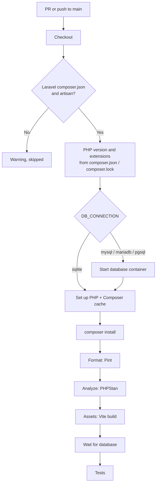

# Laravel CI

Workflow that checks every PR and push of a Laravel app. It installs the Composer
dependencies and runs:

| Step | Command | What it checks | Default |
|---|---|---|---|
| **Format** | `vendor/bin/pint --test` | The code is formatted as Pint would leave it | Off |
| **Analyze** | `vendor/bin/phpstan analyse` | Type errors and bugs found by PHPStan (Larastan for Laravel) | Off |
| **Assets** | `npm ci && npm run build` | The Vite build compiles | Off |
| **Test** | `php artisan test` | Unit and feature tests (Pest or PHPUnit) against a real database | **On** |

Each optional step runs only if the project has the tool: turning on `format` in a project
without Pint skips it with a notice.

- Workflow: [`.github/workflows/php-laravel-ci.yml`](../.github/workflows/php-laravel-ci.yml)
- Caller sample (call mode): [`examples/php-laravel-ci.yml`](../examples/php-laravel-ci.yml)
- Actions: `shivammathur/setup-php` 2.40.0, `actions/cache` v6.1.0, and for the assets step
  `actions/setup-node` v7.1.0 and `pnpm/action-setup` v6.1.0, pinned by commit SHA
- Repo access: `contents: read`. No secrets.

---

## Requirements

A Laravel app in `WORKING_DIRECTORY`: a `composer.json` that requires `laravel/framework`, and
the `artisan` file. Without them the workflow skips with a warning and the run stays green.
Laravel packages (tested with Orchestra Testbench) aren't supported.

Recommended: **`composer.lock` committed.** CI then installs exactly those versions.

---

## What it detects

**PHP version**, first match wins:

1. `PHP_VERSION`
2. `config.platform.php` in `composer.json`, as major.minor (`8.3.12` → `8.3`)
3. The lowest version that `composer.json` (`require.php`) **and every package in
   `composer.lock`** accept. For example, `composer.json` says `^8.3` but the lock has
   Symfony 8, which needs `>=8.4.1`: CI uses 8.4, since `composer install` would fail on 8.3.
4. The latest stable, with a notice suggesting to set `require.php`

Testing the lowest version catches code that uses newer PHP features than the app declares.
To test on the version your server runs instead, set `PHP_VERSION`, or
`config.platform.php` (which also keeps `composer update` from picking packages that need a
newer PHP).

**PHP extensions:** `mbstring`, `dom`, `fileinfo`, `tokenizer`, `xml`, `ctype`, `curl`, the
database driver (`pdo_sqlite`, `pdo_mysql` or `pdo_pgsql`), every `ext-*` that
`composer.json` or a package in `composer.lock` requires, and `PHP_EXTENSIONS`.

**Test runner:** `php artisan test` when `nunomaduro/collision` is installed (every Laravel
app), else `vendor/bin/pest`, else `vendor/bin/phpunit`. The test step is skipped with a
notice without a `phpunit.xml` (or `.dist`).

**Analyze:** needs `phpstan/phpstan` installed (Larastan brings it) and a `phpstan.neon`,
`phpstan.neon.dist` or `phpstan.dist.neon`. It runs without a memory cap. Errors show as
annotations on the PR's files.

**Assets:** needs a `build` script in `package.json`. The package manager comes from the
lockfile (npm, pnpm or Yarn); a missing lockfile fails. The Node version from `.nvmrc` or
`.node-version`, else the latest LTS.

---

## The test environment

The test step sets these as real environment variables. They take precedence over the
`<env>` entries in `phpunit.xml` and over `.env`, so the database is always the one chosen in
`DB_CONNECTION`:

| Variable | `sqlite` | `mysql` / `mariadb` | `pgsql` |
|---|---|---|---|
| `DB_CONNECTION` | `sqlite` | `mysql` / `mariadb` | `pgsql` |
| `DB_DATABASE` | `:memory:` | `testing` | `testing` |
| `DB_HOST` / `DB_PORT` | — | `127.0.0.1` / `3306` | `127.0.0.1` / `5432` |
| `DB_USERNAME` / `DB_PASSWORD` | — | `root` / `password` | `postgres` / `password` |

The database servers run as containers on the runner (`mysql:8.4`, `mariadb:11.8`,
`postgres:18` unless `DB_VERSION` says otherwise). They start before PHP is set up, so they
boot while the dependencies install. The credentials are fixed and harmless: the server only
listens on the runner's `127.0.0.1` and is gone when the job ends.

Also:

- **`.env`:** copied from `.env.example` when it doesn't exist, as `composer setup` does.
- **`APP_KEY`:** a random key per run, unless `phpunit.xml` sets one. Without a key, any test
  that touches sessions or encryption fails with `MissingAppKeyException`.
- `APP_ENV=testing` and the rest of `phpunit.xml`'s `<env>` entries apply as usual. A
  `.env.testing`, if committed, is loaded too.

---

## Usage

The same file supports two modes. Pick one per repo.

| | A) Copy (main use) | B) Call |
|---|---|---|
| Works for | Any repo, any organization | Any repo, any organization whose Actions policy allows workflows from `rubone/shared-workflows` |
| What goes in the project repo | The whole `php-laravel-ci.yml` | A short caller ([example](../examples/php-laravel-ci.yml)) |
| Where values go | Top-level `env:` of the copied file | `with:` inputs in the caller |
| Trigger | `on:` in the copied file (PRs and pushes to `main`) | `on:` in the caller |

### A) Copy

1. Copy [`.github/workflows/php-laravel-ci.yml`](../.github/workflows/php-laravel-ci.yml) to
   `.github/workflows/` in the target repo.
2. Set `STEPS` to the steps the project is ready for, e.g. `'format,analyze,test'`. If the
   app uses MySQL or PostgreSQL features (JSON columns, full-text search, raw SQL), set
   `DB_CONNECTION` to the database production runs.
3. If `composer.json` isn't at the root, set `WORKING_DIRECTORY`.
4. If the default branch isn't `main`, change `on.pull_request.branches` and
   `on.push.branches`.

### B) Call

```yaml
name: Laravel CI

on:
  pull_request:
    branches: [main]
  push:
    branches: [main]

permissions: {}

jobs:
  laravel-ci:
    permissions:
      contents: read
    uses: rubone/shared-workflows/.github/workflows/php-laravel-ci.yml@v1
    with:
      steps: 'format,analyze,test'
      db_connection: 'mysql'
```

**Several PHP versions or databases:** a matrix.

```yaml
jobs:
  laravel-ci:
    strategy:
      fail-fast: false
      matrix:
        php: ['8.4', '8.5']
    permissions:
      contents: read
    uses: rubone/shared-workflows/.github/workflows/php-laravel-ci.yml@v1
    with:
      php_version: ${{ matrix.php }}
```

---

## Values

| `env` (copy) | Input (call) | Default | Description |
|---|---|---|---|
| `WORKING_DIRECTORY` | `working_directory` | `.` | Folder with `composer.json` and `artisan`, relative to the repo root. |
| `PHP_VERSION` | `php_version` | `''` | PHP version (`8.4`). Empty = detect (see above). |
| `PHP_EXTENSIONS` | `php_extensions` | `''` | Extra extensions, comma-separated (`redis, imagick`). |
| `STEPS` | `steps` | `test` | Steps to run, comma-separated: `format`, `analyze`, `assets`, `test`. |
| `DB_CONNECTION` | `db_connection` | `sqlite` | `sqlite` (in memory), `mysql`, `mariadb` or `pgsql`. |
| `DB_VERSION` | `db_version` | `''` | Image tag of the database server. Empty = `8.4` (MySQL), `11.8` (MariaDB), `18` (PostgreSQL). |
| `NODE_VERSION` | `node_version` | `''` | Node for the assets step. Empty = `.nvmrc` / `.node-version`, else the latest LTS. |

In call mode, an empty input falls back to the `env` value.

Outputs: none. The job summary shows the PHP version, the database, each step's result and
the test totals.

### Caches

- **Composer** (downloaded packages, keyed on `composer.lock`): from any branch.
- **npm or Yarn 1** (assets step): `actions/setup-node`. **pnpm:** its store, through
  `pnpm/action-setup`. Yarn 2+ isn't cached.

---

## How it works



Optional steps that aren't in `STEPS` are skipped. Steps stop at the first failure: a
formatting error doesn't wait for the tests. A new push to the same PR cancels the run in
progress.

---

## Verify

1. Merge the workflow to `main` (copy mode), or add the caller.
2. Open a PR. The **Detect project** step of **Laravel build and test** shows the PHP version
   and where it came from, the extensions and the steps that will run. The job summary lists
   each step and the test totals.

To require it before merging, add **Laravel build and test** (copy mode) or **laravel-ci /
Laravel build and test** (call mode, if the caller's job is called `laravel-ci`) to the
required status checks in **Settings → Rules → Rulesets**.

---

## Troubleshooting

| Symptom | Cause | Fix |
|---|---|---|
| Warning `No composer.json in '.'` | The app is in a subfolder | Set `WORKING_DIRECTORY` |
| Warning `isn't a Laravel app` | No `laravel/framework` in `composer.json`, or no `artisan` | Not supported by this workflow (packages, other frameworks) |
| `composer install` fails with `Your lock file does not contain a compatible set of packages` / `requires php >=x.y` | The detected PHP is lower than a locked package needs, e.g. `PHP_VERSION` is set too low | Raise `PHP_VERSION`, or run `composer update` on the lowest PHP you support |
| `composer install` warns the lock file is out of date | `composer.json` changed without `composer update` | Run `composer update --lock` and commit `composer.lock` |
| `could not find driver` | A connection that doesn't match `DB_CONNECTION` (e.g. a second connection in `config/database.php`) | Add its extension to `PHP_EXTENSIONS` (`pdo_mysql`, `pdo_pgsql`) |
| `MissingAppKeyException` | `phpunit.xml` sets an empty `APP_KEY` | Remove it from `phpunit.xml`, so the workflow sets one |
| `Vite manifest not found` | Views use `@vite` and the assets aren't built | Add `assets` to `STEPS`, or call `$this->withoutVite()` in the tests |
| Tests pass on SQLite, fail in production | SQLite accepts things MySQL/PostgreSQL don't (and the reverse) | Set `DB_CONNECTION` to the production database |
| Format fails | Code isn't formatted | Run `vendor/bin/pint` and commit |
| Missing extension (`ext-redis`, `ext-gd`…) | A package uses it without requiring it | Add it to `PHP_EXTENSIONS` |

## Possible extensions

- Code coverage (`coverage: pcov` and `--coverage --min=80`) with a summary in the job.
- Redis as a second service, for apps that test queues or cache against it.
- `composer audit` as a step (dependency review already checks Composer dependencies on PRs).
- Browser tests with Laravel Dusk or Pest's browser plugin.
- Laravel packages tested with Orchestra Testbench across Laravel versions.
