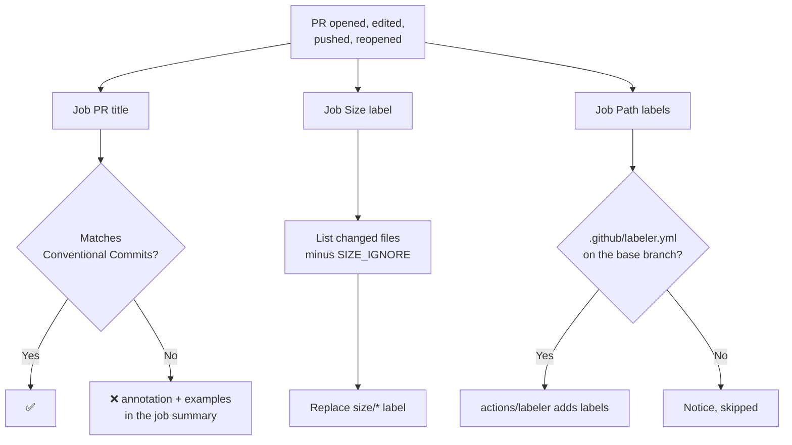

# PR checks

Workflow that keeps pull requests consistent. It runs three independent jobs:

| Job | What it does | Fails the PR? |
|---|---|---|
| **PR title** | Checks the title follows [Conventional Commits](https://www.conventionalcommits.org/) (`feat: …`, `fix(api): …`) | Yes, until the title is fixed |
| **Size label** | Adds `size/XS` … `size/XL` from the lines changed, leaving out lockfiles and generated code | No |
| **Path labels** | Adds labels from the changed paths (`frontend`, `docs`, `ci`…) using the project's `.github/labeler.yml` | No |

- Workflow: [`.github/workflows/pr-checks.yml`](../.github/workflows/pr-checks.yml)
- Caller sample (call mode): [`examples/pr-checks.yml`](../examples/pr-checks.yml)
- Labeler config sample: [`examples/labeler.yml`](../examples/labeler.yml)
- Action: `actions/labeler` v7.0.0, pinned by commit SHA (path labels only)
- Repo access: `contents: read`, `pull-requests: write`, `issues: write`. No checkout.

---

## Why the PR title

With **squash merge**, each PR lands on `main` as one commit whose message is the PR title.
Validating the title means every commit on `main` follows Conventional Commits, which release
tools (release-please, as in [release](release.md)) read to pick the next version and write
the changelog:

| Title | Release |
|---|---|
| `fix: …` | Patch (`1.2.3` → `1.2.4`) |
| `feat: …` | Minor (`1.2.3` → `1.3.0`) |
| `feat!: …`, `fix!: …` | Major (`1.2.3` → `2.0.0`) |
| `docs:`, `chore:`, `ci:`, `test:`… | No release |

Commits inside the branch aren't checked: write them however you like (with emoji, WIP…).
Only the title matters, because it's what reaches `main`.

### Recommended repo settings

**Settings → General → Pull Requests:**

1. Leave only **Allow squash merging** checked.
2. **Default commit message:** *Pull request title* (or *Pull request title and description*).

With merge commits, the branch's commits land on `main` as they are, and the validated title
is only used in the "Merge pull request #…" commit, which release tools ignore.

To block merging until the title is valid, add a ruleset on `main` (**Settings → Rules →
Rulesets**) with **Require status checks to pass** and the check **PR title** (copy mode) or
**pr-checks / PR title** (call mode, if the caller's job is called `pr-checks`).

---

## Requirements

None for the title and size checks. Path labels need a `.github/labeler.yml` in the project
repo; without it, that job is skipped with a notice.

### Why `pull_request_target`

On `pull_request`, PRs from forks get a read-only token, so labels can't be added.
`pull_request_target` gives a write token, and it's safe here because **no job checks out or
runs code from the PR**: they only read the title, the list of changed files, and the labeler
config from the base branch. Keep it that way if you edit the copied file: never add
`actions/checkout` of the PR's head to it.

Side effect: GitHub runs the workflow file **from the base branch**. A PR that adds or changes
`pr-checks.yml` (or `.github/labeler.yml`) doesn't run the new version; it takes effect after
merging.

---

## Usage

The same file supports two modes. Pick one per repo.

| | A) Copy (main use) | B) Call |
|---|---|---|
| Works for | Any repo, any organization | Any repo, any organization whose Actions policy allows workflows from `rubone/shared-workflows` |
| What goes in the project repo | The whole `pr-checks.yml` | A short caller ([example](../examples/pr-checks.yml)) |
| Where values go | Top-level `env:` of the copied file | `with:` inputs in the caller |
| Trigger | `on.pull_request_target` in the copied file | `on:` in the caller (use `pull_request_target` with the same `types`) |

### A) Copy

1. Copy [`.github/workflows/pr-checks.yml`](../.github/workflows/pr-checks.yml) unchanged to
   `.github/workflows/` in the target repo.
2. If the default branch isn't `main`, change `on.pull_request_target.branches`.
3. Optional: copy [`examples/labeler.yml`](../examples/labeler.yml) to `.github/labeler.yml` and
   keep only the labels that fit the project.
4. Apply the [recommended repo settings](#recommended-repo-settings).

### B) Call

```yaml
name: PR checks

on:
  pull_request_target:
    types: [opened, edited, synchronize, reopened, ready_for_review]
    branches: [main]

permissions: {}

jobs:
  pr-checks:
    permissions:
      contents: read
      pull-requests: write
      issues: write
    uses: rubone/shared-workflows/.github/workflows/pr-checks.yml@v1
```

Keep `edited` in `types`: it re-runs the title check when the title changes. The calling job
must grant the three permissions.

---

## Values

| `env` (copy) | Input (call) | Default | Description |
|---|---|---|---|
| `TITLE_TYPES` | `title_types` | `feat,fix,docs,style,refactor,perf,test,build,ci,chore,revert` | Types allowed in the title. |
| `REQUIRE_SCOPE` | `require_scope` | `'false'` | `'true'` = the title needs a scope: `feat(api): …`. |
| `SIZE_THRESHOLDS` | `size_thresholds` | `10,30,100,500` | Lines changed where `size/S`, `size/M`, `size/L` and `size/XL` start. Below the first, `size/XS`. `off` = no size label. |
| `SIZE_IGNORE` | `size_ignore` | lockfiles, `*.g.dart`, `*.freezed.dart`, `*.Designer.cs`, `*.min.js`, `*.snap` | Comma-separated globs left out of the size. Matched against the full path and the file name. |
| `LABELER_CONFIG` | `labeler_config` | `.github/labeler.yml` | Path of the labeler config in the project repo. |

Outputs: none.

### Title rules

The format is `type(optional scope)!: description`:

| Title | Valid? | Why |
|---|---|---|
| `feat: add login with Google` | ✅ | |
| `fix(api): handle empty cart` | ✅ | With scope |
| `feat!: drop support for Node 18` | ✅ | `!` = breaking change |
| `Revert "feat: add login"` | ✅ | GitHub's default title for revert PRs |
| `Add login` | ❌ | No type |
| `Feat: add login` | ❌ | Types are lowercase |
| `feat:add login` | ❌ | Needs a space after `:` |
| `feature: add login` | ❌ | `feature` isn't in `TITLE_TYPES` |
| `feat (api): add login` | ❌ | No space before the scope |

PRs opened by `dependabot[bot]` and `renovate[bot]` skip the check. To make their titles
conventional anyway (so they show up properly in the changelog), set the prefix in
`.github/dependabot.yml`:

```yaml
updates:
  - package-ecosystem: npm
    directory: /
    schedule: { interval: weekly }
    commit-message:
      prefix: chore(deps)
```

### Size labels

| Label | Lines changed (default) |
|---|---|
| `size/XS` | 0–9 |
| `size/S` | 10–29 |
| `size/M` | 30–99 |
| `size/L` | 100–499 |
| `size/XL` | 500+ (also leaves a notice suggesting to split the PR) |

"Lines changed" = additions + deletions, without files matching `SIZE_IGNORE`. The labels are
created with colors on first use. When a new push changes the size, the old label is replaced.

### Path labels

Uses [`actions/labeler`](https://github.com/actions/labeler) with the project's
`.github/labeler.yml`. Each key is a label name, created on first use:

```yaml
frontend:
  - changed-files:
      - any-glob-to-any-file: ['**/*.ts', '**/*.tsx', '**/*.html', '**/*.scss']
```

[`examples/labeler.yml`](../examples/labeler.yml) has labels for the supported stacks
(`backend`, `frontend`, `flutter`, `android`, `docker`, `infra`, `dependencies`, `tests`,
`documentation`, `ci`). Labels are only added, never removed, when files stop matching.

---

## How it works



---

## Verify

1. Merge the workflow (and optionally `.github/labeler.yml`) to the project's `main`.
2. Open a PR titled `update readme`. The **PR title** check fails, and the job summary shows
   the expected format.
3. Rename it to `docs: update readme`. The check runs again and passes.
4. The PR gets a `size/*` label and, with a labeler config, the matching path labels.

---

## Troubleshooting

| Symptom | Cause | Fix |
|---------|-------|-----|
| The check doesn't run after editing the title | `edited` is missing from `types` (call mode) | Add it to the caller's `on.pull_request_target.types` |
| Changes to `pr-checks.yml` or `labeler.yml` in a PR have no effect | `pull_request_target` uses the files from the base branch | Expected; they apply after merging |
| Warning `Can't write labels with this token` | Fork PR with the `pull_request` trigger (read-only token) | Use `pull_request_target`, as in the examples |
| `Resource not accessible by integration` in the labeler step | Call mode: the caller didn't grant `pull-requests: write` / `issues: write` | Add the three permissions to the calling job |
| Notice `No .github/labeler.yml on the base branch` | No labeler config, or not merged yet | Add it from `examples/labeler.yml` |
| `size/XL` on a small change | Big generated or vendored files not in `SIZE_IGNORE` | Add their globs to `SIZE_IGNORE` |
| Dependabot PRs show odd titles in the changelog | Their titles aren't conventional (the check skips them) | Set `commit-message.prefix` in `dependabot.yml` |
| Title passes but `main` gets a different commit message | Merge method isn't squash, or the default message isn't the PR title | Apply the [recommended repo settings](#recommended-repo-settings) |

## Possible extensions

- Require a ticket ID in the title or branch (e.g. Jira `ABC-123`).
- `sync-labels` to remove path labels when files stop matching.
- Check that the PR has a description, or a linked issue.
