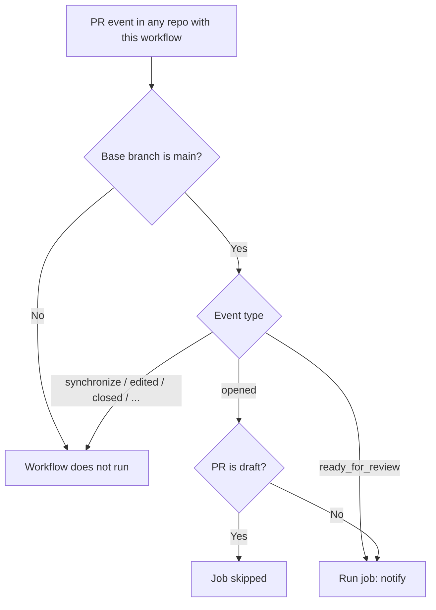
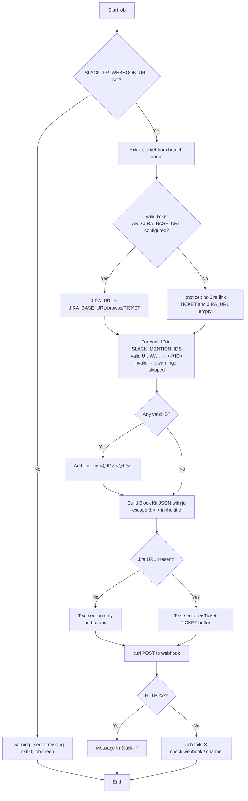

# PR Slack notification

GitHub Action that posts a message to a Slack channel when a pull request to `main` is opened.
The repo name and URLs are read from the event payload, so the same workflow file can be copied
as-is to other repos (see [Reusing in other repos](#reusing-in-other-repos)). If the branch name contains a Jira ticket, the message includes a button that
opens that ticket in Jira. The repo's project owner(s) can be tagged in Slack (`cc @owner`),
configured in the workflow file with `SLACK_MENTION_IDS`.

- Workflow: [`.github/workflows/pr_slack_notify.yml`](../.github/workflows/pr_slack_notify.yml)
- Delivery: Slack [Incoming Webhook](https://api.slack.com/messaging/webhooks) (plain `curl`, no third-party action)
- Repo access: none (`permissions: {}`, no checkout). The job only reads the event payload.

---

## Values to configure

Complete #1 → #2 → #3 in that order, since each one needs the previous;
#4 and #5 are independent.

| # | Value | Where | Depends on | Done | Owner |
|---|-------|-------|------------|------|-------|
| 1 | Target Slack channel | Slack | — | ☐ | Team |
| 2 | Slack app + Incoming Webhook for that channel ([Setup 1](#1-slack-create-the-app-and-the-webhook)) | api.slack.com/apps | #1 | ☐ | Slack admin |
| 3 | `SLACK_PR_WEBHOOK_URL` secret = the webhook URL from #2 ([Setup 2](#2-github-add-the-secret)) | GitHub → repo (or org) Settings → Secrets and variables → Actions | #2 | ☐ | Repo admin |
| 4 | `JIRA_BASE_URL` = your Jira site, e.g. `https://<your-domain>.atlassian.net` ([Setup 4](#4-repo-set-the-jira-base-url)) | `.github/workflows/pr_slack_notify.yml`, top-level `env` | — | ☐ | Dev |
| 5 | `SLACK_MENTION_IDS` = Slack member ID(s) of the project owner(s), e.g. `U01ABCDEFG` ([Setup 3](#3-repo-tag-the-project-owners)) | `.github/workflows/pr_slack_notify.yml`, top-level `env` | — | ☐ | Dev |

Until #3 is set, the job
**skips with a warning** and stays green, so the workflow can be merged before Slack is ready.

---

## How it works

### Trigger



- **opened**: a new PR, unless it is a draft.
- **ready_for_review**: a draft PR is marked ready, so drafts are announced once, when they
  are actually ready.
- New commits, edits, reviews, merges and closes do **not** notify.

### Job steps



### Ticket extraction

1. Take the PR's source branch (`head.ref`).
2. Find the first `PROJECT-123` token that sits **at the start** of the branch name or **right after a `/`**.
   Regex: `(^|/)[A-Za-z][A-Za-z0-9]+-[0-9]+`
3. Convert it to uppercase.
4. Validate it: `^[A-Z][A-Z0-9]+-[1-9][0-9]*$`. The number can't be `0` or start with `0`.
5. The link is built only if the ticket is valid **and** `JIRA_BASE_URL` is a valid `https://host`.

| Branch | Ticket | Ticket button |
|--------|--------|-------------|
| `PROJ-1234-add-orders-model` | `PROJ-1234` | ✅ |
| `feat/ABC-1189-update-dashboard` | `ABC-1189` | ✅ |
| `team-42-fix-model` | `TEAM-42` | ✅ (uppercased) |
| `chore/pr-slack-notify` | — | ❌ |
| `main` / `hotfix` | — | ❌ |
| `PROJ-0-test` | — (invalid number) | ❌ |
| `fix-PROJ-12-model` | — (not at start or after `/`) | ❌ |

Any Jira project key that matches the pattern works (e.g. `PROJ`, `ABC`, `TEAM`).

---

## Notification examples

The message uses Slack Block Kit: a text section, plus a Ticket button (links to Jira) only when the branch has a
valid ticket. The PR link is on the title, so there is no separate PR button. The examples
below approximate how it renders in the channel (no border around the message; the
`` `Ticket …` `` chip stands for a Slack button). The `text` field is the fallback
shown in mobile push and desktop notifications.

### With a Jira ticket

Branch `PROJ-1234-add-orders-model` → `main`:

**GitHub PR Notifier** `APP` 10:42 AM\
:github: **[&lt;repo&gt;](https://github.com/<org>/<repo>) · New PR #464: [feat: add orders model](https://github.com/<org>/<repo>/pull/464)**\
by **octocat** · `PROJ-1234-add-orders-model` → `main`\
+412 / -3 · 7 files\
cc **@Project Owner**

`Ticket PROJ-1234`

Push / fallback: "[<repo>] New PR #464: feat: add orders model cc @Project Owner"

- **&lt;repo&gt;** links to the repo; the **PR title** links to the PR.
- **Ticket PROJ-1234** → `https://<your-domain>.atlassian.net/browse/PROJ-1234`
- **cc @Project Owner** is each Slack user in `SLACK_MENTION_IDS`; Slack shows their display
  names and notifies them. With an empty list, this line isn't there.

### Without a ticket

Branch `chore/pr-slack-notify` → `main`:

**GitHub PR Notifier** `APP` 11:05 AM\
:github: **[&lt;repo&gt;](https://github.com/<org>/<repo>) · New PR #465: [chore: add PR Slack notification workflow](https://github.com/<org>/<repo>/pull/465)**\
by **octocat** · `chore/pr-slack-notify` → `main`\
+95 / -0 · 2 files

No buttons: the message is just the text section.

The Actions log shows:
`Notice: No valid Jira ticket in branch 'chore/pr-slack-notify' (or JIRA_BASE_URL not set); sending without Jira link.`

### JSON payload sent to Slack (with ticket)

```json
{
  "text": "[<repo>] New PR #464: feat: add orders model\ncc <@U01ABCDEFG>",
  "blocks": [
    {
      "type": "section",
      "text": {
        "type": "mrkdwn",
        "text": ":github: *<https://github.com/<org>/<repo>|<repo>> · New PR #464: <https://github.com/<org>/<repo>/pull/464|feat: add orders model>*\nby *octocat* · `PROJ-1234-add-orders-model` → `main`\n+412 / -3 · 7 files\ncc <@U01ABCDEFG>"
      }
    },
    {
      "type": "actions",
      "elements": [
        { "type": "button", "text": { "type": "plain_text", "text": "Ticket PROJ-1234" }, "url": "https://<your-domain>.atlassian.net/browse/PROJ-1234" }
      ]
    }
  ]
}
```

You can paste the `blocks` array into the [Block Kit Builder](https://app.slack.com/block-kit-builder)
to preview the message.

---

## Setup

### 1. Slack: create the app and the webhook

Needs a Slack workspace admin, or app-install approval if the workspace restricts apps.

1. Go to <https://api.slack.com/apps> → **Create New App** → **From scratch**.
   - App name: e.g. `GitHub PR Notifier` (generic, so one app serves every repo)
   - Workspace: your organization's workspace
2. *(Optional)* **Basic Information → Display Information**: set an icon and a short
   description (e.g. "Notifies new GitHub PRs").
3. **Features → Incoming Webhooks** → switch **Activate Incoming Webhooks** to **On**.
4. Click **Add New Webhook to Workspace**, pick the target channel (e.g. `#pr-notifications`) → **Allow**.
   - For a **private** channel, the person installing must be a member of it.
   - If the workspace requires approval, this sends a request to the admins. Wait for approval
     and repeat this step.
5. Copy the generated URL. Format: `https://hooks.slack.com/services/T*********/B**********/************************`
   (`T…` = workspace ID, `B…` = webhook ID, last part = token).
   - Treat it as a password: anyone with it can post to the channel.
   - Don't paste it into code, PRs, Jira or Slack messages.
6. *(Optional)* Test it from a terminal:
   ```bash
   curl -X POST -H 'Content-Type: application/json' \
     --data '{"text":"Test from GitHub PR Notifier"}' \
     'https://hooks.slack.com/services/XXX/YYY/ZZZ'
   ```
   The response should be `ok`, and the message should appear in the channel.

Each webhook is tied to **one channel**. To change the channel, create a new webhook and
update the GitHub secret.

### 2. GitHub: add the secret

1. In each repo that uses the workflow → **Settings → Secrets and variables → Actions**.
   (Or once at org level; see [Reusing in other repos](#reusing-in-other-repos).)
2. **New repository secret**:
   - Name: `SLACK_PR_WEBHOOK_URL`
   - Secret: the webhook URL from step 1.5
3. Save. Requires repo admin permission.

### 3. Repo: tag the project owner(s)

Slack only notifies someone when the message uses their **member ID** (`<@U01ABCDEFG>`). A plain
`@username` shows as text and notifies nobody, so the list holds IDs, not usernames.

1. Get each member ID: in Slack, open the person's profile → **⋮ (More)** → **Copy member ID**.
   It looks like `U01ABCDEFG`.
2. Edit `.github/workflows/pr_slack_notify.yml`, top-level `env`, separating IDs with spaces or commas:
   ```yaml
   env:
     SLACK_MENTION_IDS: 'U01ABCDEFG'                 # one owner
     # SLACK_MENTION_IDS: 'U01ABCDEFG, U02HIJKLMN'   # several owners
   ```
3. Leave it empty (`''`) to tag nobody. Entries that aren't member IDs (`U…` / `W…`) are skipped
   with a warning in the job log.

The list lives in the workflow file on purpose: no extra GitHub variable to manage. **Each repo
that reuses the workflow must set its own list.** Member IDs aren't secret, so they're fine in code.

### 4. Repo: set the Jira base URL

In `.github/workflows/pr_slack_notify.yml`, replace the placeholder with your Jira site:

```yaml
env:
  JIRA_BASE_URL: 'https://<your-domain>.atlassian.net'   # no trailing slash
```

The value must match `^https://[A-Za-z0-9.-]+$`: no path and no trailing `/`. Otherwise
the link is skipped.

### 5. Verify

1. Merge the workflow to `main`. The `pull_request` trigger uses the workflow file from the PR,
   but having it on `main` keeps it active for every new branch.
2. Open a test PR from a branch with a ticket, e.g. `PROJ-12345-test-slack-notify`.
3. Check **Actions → PR Slack notification**: the job should be green, and the message should
   appear in the channel with the Ticket button and, if `SLACK_MENTION_IDS` is set, the owner(s) tagged.
4. Close the test PR without merging.

---

## Reusing in other repos

The repo name, repo URL and PR URLs come from `github.event.repository` /
`github.event.pull_request`, so the only repo-specific value is `SLACK_MENTION_IDS`. To add it to
another repo:

1. Copy `.github/workflows/pr_slack_notify.yml` into the other repo.
2. Make `SLACK_PR_WEBHOOK_URL` available to it, either:
   - **Org secret** (recommended): GitHub org → **Settings → Secrets and variables → Actions →
     New organization secret**, and give the repos access to it. All repos then post to the same
     channel, and the repo name in the message tells them apart.
   - **Repo secret**: a different webhook per repo, to send each repo's PRs to its own channel.
3. **Set `SLACK_MENTION_IDS`** in the copied file to that repo's project owner(s), or `''` for none.
   Otherwise the previous repo's owner would be tagged.
4. Set `JIRA_BASE_URL` to your Jira site (e.g. `https://<your-domain>.atlassian.net`, no trailing slash),
   unless the copied file already has it.
5. If the repo's default branch isn't `main`, change `on.pull_request.branches`.

## Troubleshooting

| Symptom | Cause | Fix |
|---------|-------|-----|
| Job green, warning `SLACK_PR_WEBHOOK_URL secret is not set` | Secret missing or misspelled | Create or rename the secret (step 2) |
| Job fails on `curl` with `403` / `404` | Webhook revoked, or the app was removed from the channel | Create a new webhook and update the secret |
| Job fails with `400 invalid_blocks` | Payload changed and is no longer valid Block Kit | Validate in the Block Kit Builder |
| Message has no Ticket button | Branch has no valid ticket, or `JIRA_BASE_URL` was changed to an invalid value | Check the Notice in the job log |
| No `cc` line | `SLACK_MENTION_IDS` is empty, or none of its entries are valid | Add the member ID(s) (Setup 3) |
| Warning `SLACK_MENTION_IDS entry '…' is not a Slack member ID` | A username or name instead of the ID | Replace it with the member ID (`U…`) |
| `cc` line shows but nobody gets notified | ID belongs to another workspace, or the user left | Copy the member ID again from Slack |
| No run at all | PR is a draft, or its base isn't `main` | Mark it ready for review / retarget it to `main` |
| No message for a PR from a fork | Secrets aren't passed to fork PRs on `pull_request` | Not expected in this private repo. If needed, switch to `pull_request_target` (safe here, since there's no checkout) |

## Possible extensions

- Notify on `reopened`, merges (`closed` + `merged == true`) or approvals.
- Mention reviewers or a Slack user group (`<!subteam^ID>`) in the text.
- Use a repo **variable** (`vars.JIRA_BASE_URL`) instead of hard-coding the Jira URL.
