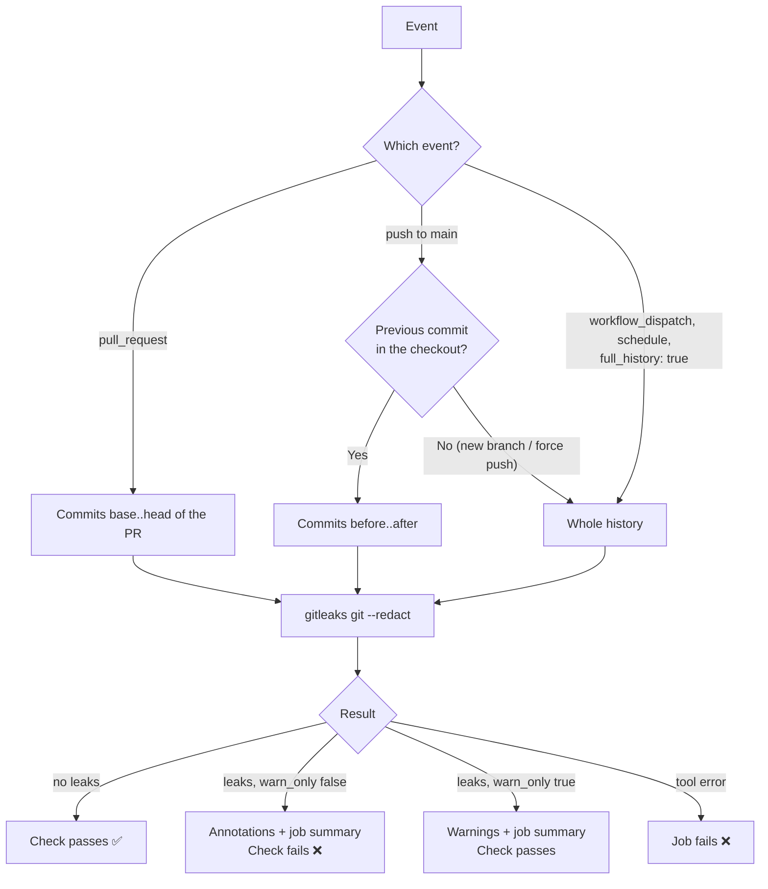

# Secret scan

Workflow that looks for secrets (API keys, tokens, private keys, connection strings...) in the
commits of a pull request or push and fails the check when it finds one. It runs the
[gitleaks](https://github.com/gitleaks/gitleaks) CLI, which has
[rules for hundreds of providers](https://github.com/gitleaks/gitleaks/blob/master/config/gitleaks.toml)
(GitHub, Azure, AWS, Slack, Stripe, Firebase, private keys and more). It doesn't depend on the
project's language, so it works the same for every stack.

- Workflow: [`.github/workflows/secret-scan.yml`](../.github/workflows/secret-scan.yml)
- Caller sample (call mode): [`examples/secret-scan.yml`](../examples/secret-scan.yml)
- Tool: gitleaks CLI 8.30.1, downloaded from its GitHub release and checked against a pinned SHA-256
- Repo access: `contents: read` only

---

## Requirements

None. It works in public and private repos, in any organization, without GitHub Advanced
Security and without a license key.

> **Why the CLI and not `gitleaks/gitleaks-action`?**
>
> - Since v2, `gitleaks-action` is no longer MIT: it has its own
>   [license](https://github.com/gitleaks/gitleaks-action/blob/master/LICENSE.txt).
> - For repos owned by an **organization**, it requires a `GITLEAKS_LICENSE` secret. The key is
>   free, but each organization has to request it on [gitleaks.io](https://gitleaks.io) (a form
>   with name, email and company) and store it as a repo or org secret. Without it, the action
>   fails. Repos under a personal account don't need it.
> - That breaks the goal of this repo: copy one file into any organization and have it work.
>
> The gitleaks **CLI** that this workflow downloads is MIT-licensed, needs no key, and runs the
> same rules. Features the action adds (PR comments, SARIF artifact) aren't needed here: the
> findings show as annotations and in the job summary.

### Relation to GitHub secret scanning

GitHub has its own secret scanning and push protection. It's free for public repos; private
repos need GitHub Secret Protection. Where you have it, turn it on as well: **push protection
blocks the push** before the secret reaches GitHub, while this workflow only finds it after the
fact. This workflow covers the repos where that isn't available and gives the same check in
every organization.

---

## Usage

The same file supports two modes. Pick one per repo.

| | A) Copy (main use) | B) Call |
|---|---|---|
| Works for | Any repo, any organization | Repos of the same owner as `rubone/shared-workflows` (or any repo, if this one is public) |
| What goes in the project repo | The whole `secret-scan.yml` | A short caller ([example](../examples/secret-scan.yml)) |
| Where values go | Top-level `env:` of the copied file | `with:` inputs in the caller |
| Trigger | `on:` in the copied file | `on:` in the caller |

### A) Copy

1. Copy [`.github/workflows/secret-scan.yml`](../.github/workflows/secret-scan.yml) unchanged to
   `.github/workflows/` in the target repo.
2. If the default branch isn't `main`, change `on.pull_request.branches` and `on.push.branches`.
3. Run it once by hand (**Actions → Secret scan → Run workflow**) to scan the whole history.
   See [Adopting it in an existing repo](#adopting-it-in-an-existing-repo).

No secrets are needed.

### B) Call

```yaml
name: Secret scan

on:
  pull_request:
    branches: [main]
  push:
    branches: [main]
  workflow_dispatch:

permissions: {}

jobs:
  secret-scan:
    permissions:
      contents: read
    uses: rubone/shared-workflows/.github/workflows/secret-scan.yml@v1
```

The calling job must grant `contents: read` (the checkout needs it).

---

## Values

| `env` (copy) | Input (call) | Default | Description |
|---|---|---|---|
| — | `full_history` (boolean) | `false` | `true` = scan the whole history. In copy mode, use the manual run (`workflow_dispatch`). |
| `WARN_ONLY` | `warn_only` (boolean) | `false` | `true` = report findings as warnings and never fail. Useful while cleaning up an old repo. |
| `GITLEAKS_VERSION` | — | `8.30.1` | gitleaks version to download. |
| `GITLEAKS_SHA256` | — | checksum of 8.30.1 | SHA-256 of `gitleaks_<version>_linux_x64.tar.gz`. Change it together with the version; it's in `gitleaks_<version>_checksums.txt` on the release page. |

Outputs: none.

---

## How it works



- **Only new commits.** On a PR it scans only the PR's commits; on a push, only the pushed ones.
  Old secrets already in the history don't block every PR. The manual run finds them.
- **Checks each commit, not only the final files.** A secret added in one commit and deleted in
  the next is still found, because it's still in the git history.
- **Never prints the secret.** It runs with `--redact`. The annotations and the job summary show
  the rule, file, line, commit and a fingerprint, never the value.
- **Fails loudly on tool errors.** gitleaks treats a missing commit as "no leaks". The workflow
  checks the commits exist first and fails if they don't, so a broken checkout can't pass the
  check silently.

---

## When it finds a secret

1. **Rotate or revoke it.** Once a secret is pushed it's leaked, even if a later commit deletes
   it or the PR is closed: anyone with read access, and forks, can still see the commit.
2. **Remove it from the code** and read it from a secret store (GitHub secrets, Azure Key Vault,
   user-secrets in .NET, `.env` files listed in `.gitignore`...).
3. Optional: rewrite the history to drop it (`git filter-repo`). Only worth it for public repos
   or very sensitive values, and only after step 1.

### False positives

Choose one:

- **`.gitleaksignore`** at the repo root, one fingerprint per line. Copy it from the job summary,
  where it appears without the commit (`path/file.cs:generic-api-key:12`), so it keeps working
  after a squash merge. If the line number changes, the fingerprint must be updated.
- **Inline comment** on the line: `# gitleaks:allow` (or `// gitleaks:allow`). Simple, but it
  must be in the commit that adds the value.
- **`.gitleaks.toml`** at the repo root for repo-wide rules, e.g. skipping test fixtures:

  ```toml
  [extend]
  useDefault = true

  [[allowlists]]
  description = "Test fixtures"
  paths = ['''^tests/fixtures/''']
  ```

gitleaks reads `.gitleaksignore` and `.gitleaks.toml` from the repo root automatically.

---

## Adopting it in an existing repo

1. Add the workflow with `WARN_ONLY: 'true'` (or `warn_only: true`).
2. Run it by hand to scan the whole history, and read the job summary.
3. Rotate every real secret it finds, and add the false positives to `.gitleaksignore`.
4. Set `WARN_ONLY` back to `'false'`.

Old findings never block PRs (PRs only scan their own commits), so step 1 is only needed if you
want the manual run green while you clean up.

---

## Verify

1. Merge the workflow (or the caller) to the project's `main`.
2. Open a PR with a fake GitHub token, generated so no real token is committed:

   ```bash
   git switch -c test/secret-scan
   echo "token = ghp_$(openssl rand -hex 18)" > leak-test.txt
   git add leak-test.txt && git commit -m "test: secret scan"
   git push -u origin test/secret-scan
   ```

3. The **Secret scan (gitleaks)** check fails with an annotation on `leak-test.txt` line 1
   (`github-pat`), and the job summary lists it.
4. Close the PR without merging and delete the branch.

A PR without secrets passes with *"Secret scan: no leaks found"* in the job summary.

---

## Troubleshooting

| Symptom | Cause | Fix |
|---------|-------|-----|
| A PR fails on a value that isn't a secret | False positive | Add the fingerprint from the job summary to `.gitleaksignore` (see [False positives](#false-positives)) |
| Push to `main` fails after a squash merge, though the PR was allowed | `.gitleaksignore` has the fingerprint *with* the commit | Use the form without the commit (`file:rule:line`) |
| `Commit … not found in the checkout; can't scan the PR` | The checkout didn't fetch the PR's commits (e.g. `fetch-depth` changed) | Keep `fetch-depth: 0` in the checkout step |
| `sha256sum: WARNING: 1 computed checksum did NOT match` | `GITLEAKS_VERSION` changed without `GITLEAKS_SHA256` | Update both together from the release's checksums file |
| `gitleaks failed (exit code 1)` | Tool error (bad `.gitleaks.toml`, git error) | Read the log above the error; validate the TOML |
| Push scan says *Scanning the whole git history* | New branch or force push: the previous commit isn't available | Expected; old findings may appear. Clean them up or allow them |
| Slow on big repos | `fetch-depth: 0` downloads the whole history | Expected; the scan itself only reads the new commits |

## Possible extensions

- SARIF upload to code scanning (needs Advanced Security on private repos).
- A weekly `schedule:` with a full-history scan.
- A shared `.gitleaks.toml` in this repo for org-specific rules (e.g. internal token formats).
