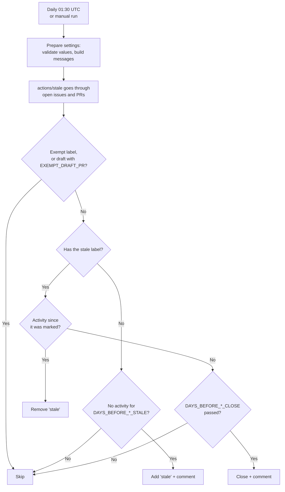

# Stale

Workflow that runs once a day and keeps issues and pull requests from piling up:

1. An issue or PR with no activity for a while gets the `stale` label and a comment.
2. If nothing happens after that, it's closed with another comment.
3. Any activity (a comment, a push, an edit) removes the label and restarts the count.

It uses the official [`actions/stale`](https://github.com/actions/stale).

- Workflow: [`.github/workflows/stale.yml`](../.github/workflows/stale.yml)
- Caller sample (call mode): [`examples/stale.yml`](../examples/stale.yml)
- Action: `actions/stale` v11.0.0, pinned by commit SHA
- Repo access: `issues: write`, `pull-requests: write`, `actions: write`. No checkout.

---

## Requirements

None. It works in public and private repos. If the repo has issues turned off, it only
processes PRs.

---

## Usage

The same file supports two modes. Pick one per repo.

| | A) Copy (main use) | B) Call |
|---|---|---|
| Works for | Any repo, any organization | Any repo, any organization whose Actions policy allows workflows from `rubone/shared-workflows` |
| What goes in the project repo | The whole `stale.yml` | A short caller ([example](../examples/stale.yml)) |
| Where values go | Top-level `env:` of the copied file | `with:` inputs in the caller |
| Trigger | `on:` in the copied file (daily + manual) | `on:` in the caller |

### A) Copy

1. Copy [`.github/workflows/stale.yml`](../.github/workflows/stale.yml) to `.github/workflows/`
   in the target repo.
2. In a repo with existing issues or PRs, set `DRY_RUN: 'true'` first (see
   [Adopting it](#adopting-it-in-an-existing-repo)).
3. Adjust the days and exempt labels in `env:` if the defaults don't fit.

Scheduled workflows only run from the default branch, so it starts after it's merged. Run it
by hand from **Actions → Stale → Run workflow** to try it right away.

### B) Call

```yaml
name: Stale

on:
  schedule:
    - cron: '30 1 * * *'
  workflow_dispatch:

permissions: {}

jobs:
  stale:
    permissions:
      issues: write
      pull-requests: write
      actions: write
    uses: rubone/shared-workflows/.github/workflows/stale.yml@v1
    with:
      dry_run: true
```

The calling job must grant the three permissions. `actions: write` is used by `actions/stale`
to keep its progress in the Actions cache between runs.

---

## Values

| `env` (copy) | Input (call) | Default | Description |
|---|---|---|---|
| `DAYS_BEFORE_ISSUE_STALE` | `days_before_issue_stale` (number) | `60` | Days without activity before an issue is marked stale. `-1` = never. |
| `DAYS_BEFORE_ISSUE_CLOSE` | `days_before_issue_close` (number) | `14` | Days after being marked stale before an issue is closed. `-1` = never (only mark). |
| `DAYS_BEFORE_PR_STALE` | `days_before_pr_stale` (number) | `30` | Same, for PRs. |
| `DAYS_BEFORE_PR_CLOSE` | `days_before_pr_close` (number) | `14` | Same, for PRs. |
| `EXEMPT_LABELS` | `exempt_labels` | `pinned,security,keep-open` | Comma-separated labels that keep an issue or PR from going stale. |
| `EXEMPT_DRAFT_PR` | `exempt_draft_pr` (boolean) | `false` | `true` = draft PRs never go stale. |
| `DRY_RUN` | `dry_run` (boolean) | `false` | `true` = log what would happen, change nothing. |
| `STALE_LABEL` | — | `stale` | Label added to stale issues and PRs. |
| `OPERATIONS_PER_RUN` | — | `100` | Max API operations per run. Whatever's left is handled the next day. |

In call mode, a number input of `0` or a boolean input of `false` falls back to the `env` value.

Outputs: none.

### Why different defaults for issues and PRs

- **PRs (30 + 14 days):** an open PR that nobody touches for a month usually means the branch is
  abandoned or conflicts with `main`. Closing it keeps the PR list useful. The branch isn't
  deleted, so the PR can be reopened.
- **Issues (60 + 14 days):** bug reports and ideas can wait longer. Issues are closed as *not
  planned*, not *completed*.

To keep something open for good, add one of the `EXEMPT_LABELS` (e.g. `keep-open`). For a
security issue that's still being worked on, use `security`.

### Messages

The comments are generated from the values, so they always state the real number of days.
With `-1` as the close value, the stale comment doesn't say it will be closed. Example with the
defaults:

> This pull request has had no activity for 30 days, so it's been marked as stale. It will be
> closed in 14 days unless there's new activity. Comment or update it to keep it open. (Labels
> that exempt it: pinned,security,keep-open.)

---

## How it works



"Activity" means any update to the issue or PR: a comment, a push, an edit, a label change by a
person. The workflow's own changes (the `stale` label and its comment) don't count.

---

## Adopting it in an existing repo

A repo with many old issues would get them all marked on the first run. To check first:

1. Set `DRY_RUN: 'true'` (or `dry_run: true`) and run it by hand.
2. Open the log of the **Mark and close stale issues and PRs** step: it lists each issue and PR
   and what it would do.
3. Add exempt labels to what must stay open, or adjust the days.
4. Set `DRY_RUN` back to `'false'`.

On a repo with many items, the first real runs process `OPERATIONS_PER_RUN` operations each
day until they catch up.

---

## Verify

1. Merge the workflow to `main`.
2. Run it by hand with `DRY_RUN: 'true'` and `DAYS_BEFORE_ISSUE_STALE: '1'`.
3. The log of the **Mark and close stale issues and PRs** step goes through the open issues and
   shows which ones it would mark as stale (older than a day), without changing them.
4. Restore the values.

---

## Troubleshooting

| Symptom | Cause | Fix |
|---------|-------|-----|
| It never runs | Scheduled workflows run only from the default branch; GitHub also pauses them after 60 days without commits in public repos | Merge it to the default branch; re-enable it from the Actions tab if paused |
| `Resource not accessible by integration` | Call mode: the caller didn't grant the permissions | Add `issues: write`, `pull-requests: write`, `actions: write` |
| `… must be a positive number of days or -1` | A days value is `0`, empty or not a number | Use a positive number, or `-1` for never |
| Something important was closed | It had no activity and no exempt label | Reopen it and add `keep-open` |
| Not everything is processed in one run | `OPERATIONS_PER_RUN` reached | Expected; it continues the next day. Raise the value if needed |
| Errors or warnings about the Actions cache | `actions: write` missing | Grant it: the action stores its progress there |

## Possible extensions

- `only-labels` / `any-of-labels` to apply it only to some issues (e.g. `question`, `needs-info`).
- `exempt-milestones` to skip issues planned in a milestone.
- `delete-branch` to delete the branch of closed PRs (needs `contents: write`).
