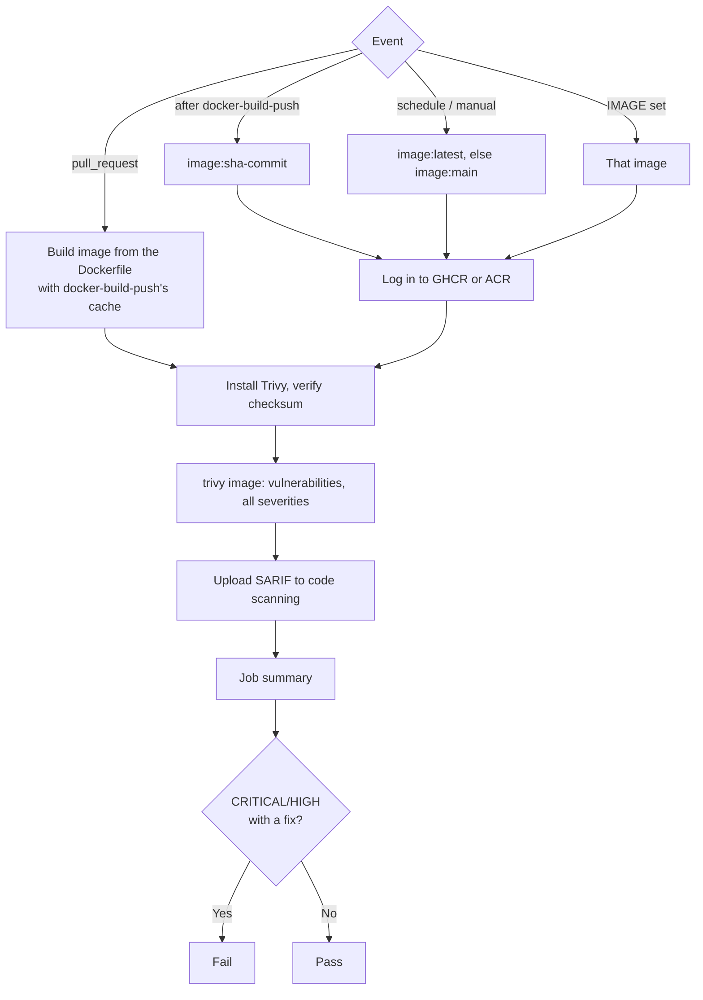

# Trivy scan

Workflow that scans a Docker image for known vulnerabilities (CVEs) in its OS packages
(Alpine, Debian, Ubuntu…) and libraries (npm, Composer, NuGet, Maven, pip… installed in the
image). It fails on **CRITICAL** and **HIGH** vulnerabilities that already have a fixed
version, reports the rest, and uploads everything to the repo's **Security → Code scanning**
when available.

It's the companion of [docker-build-push](docker-build-push.md): it scans what that workflow
builds, before and after it's published.

| When | What it scans |
|---|---|
| Pull request | The image built from the PR's Dockerfile (amd64, nothing pushed). Fails the PR before a vulnerable base image reaches `main`. |
| After docker-build-push pushes (`main`, `v*` tags) | The image just pushed, by its `sha-<commit>` tag |
| Weekly (Mondays) and manual runs | The published image: `latest`, else the default branch's tag. New CVEs come out every day for images that didn't change. |

- Workflow: [`.github/workflows/trivy-scan.yml`](../.github/workflows/trivy-scan.yml)
- Caller sample (call mode, together with docker-build-push):
  [`examples/trivy-scan.yml`](../examples/trivy-scan.yml)
- Tool: [Trivy](https://trivy.dev/) CLI 0.76.1 (Apache-2.0), pinned by checksum. For PRs,
  `docker/setup-buildx-action` and `docker/build-push-action`; for private images,
  `docker/login-action` or `azure/login`; `github/codeql-action/upload-sarif` v4.39.1. All
  pinned by commit SHA.
- Repo access: `contents: read`, `packages: read`, `id-token: write` (ACR),
  `security-events: write` and `actions: read` (code scanning). No secrets.

### Why not `aquasecurity/trivy-action`

On March 19, 2026, an attacker with stolen credentials force-pushed 76 of the 77 tags of
`aquasecurity/trivy-action` and every tag of `aquasecurity/setup-trivy` to code that stole
the runner's credentials, and published a malicious Trivy 0.69.4
([CVE-2026-33634](https://fieldguide.lutrasecurity.com/CVE-2026-33634)). This workflow
downloads the Trivy release from GitHub and checks it against a SHA-256 written in the file:
a replaced release fails the checksum instead of running.

---

## Requirements

- A **Dockerfile** (for PRs) and **docker-build-push** publishing the image (for the other
  events), or an explicit `IMAGE`. Without a Dockerfile and without `IMAGE`, the workflow
  skips with a warning and the run stays green.
- For the **Security tab**: code scanning available (public repos; private ones need GitHub
  Code Security). Without it, results are only in the job summary, with a notice.
- For images in **ACR**: an identity with the **AcrPull** role (the AcrPush identity of
  docker-build-push already has it) and the `AZURE_*` variables; see
  [ACR setup](docker-build-push.md#acr-setup). The weekly scan signs in as the default
  branch, so the `main` federated credential is enough.

---

## Usage

The same file supports two modes. Pick one per repo.

| | A) Copy (main use) | B) Call |
|---|---|---|
| Works for | Any repo, any organization | Any repo, any organization whose Actions policy allows workflows from `rubone/shared-workflows` |
| What goes in the project repo | The whole `trivy-scan.yml`, next to `docker-build-push.yml` | One workflow that calls both ([example](../examples/trivy-scan.yml)) |
| Where values go | Top-level `env:` of the copied file | `with:` inputs in the caller |
| Trigger | `on:` in the copied file: PRs, after **Docker build and push**, weekly | `on:` in the caller |

### A) Copy

1. Copy [`.github/workflows/trivy-scan.yml`](../.github/workflows/trivy-scan.yml) to
   `.github/workflows/` in the target repo, next to the copied `docker-build-push.yml`.
2. If you changed them in `docker-build-push.yml`, set the same `CONTEXT`, `DOCKERFILE`,
   `BUILD_ARGS`, `TARGET`, `REGISTRY`, `IMAGE_NAME` and `ACR_NAME`.
3. If the default branch isn't `main`, change `on.pull_request.branches`. If you renamed
   docker-build-push (its `name:`), change `on.workflow_run.workflows` to match.

The `workflow_run` trigger only fires for workflows on the default branch: the scan after
each push starts working once both files are merged.

### B) Call

Call it after docker-build-push, passing the pushed image by digest
([full example](../examples/trivy-scan.yml)):

```yaml
jobs:
  docker:
    permissions:
      contents: read
      packages: write
      id-token: write
    uses: rubone/shared-workflows/.github/workflows/docker-build-push.yml@v1

  trivy:
    needs: docker
    permissions:
      contents: read
      packages: read
      id-token: write
      security-events: write
      actions: read
    uses: rubone/shared-workflows/.github/workflows/trivy-scan.yml@v1
    with:
      image: ${{ needs.docker.outputs.digest && format('{0}@{1}', needs.docker.outputs.image, needs.docker.outputs.digest) || '' }}
```

On PRs docker-build-push pushes nothing, so `image` is empty and the scan builds the image
itself. Any other image works too: `image: 'nginx:1.29'`.

---

## Values

| `env` (copy) | Input (call) | Default | Description |
|---|---|---|---|
| `IMAGE` | `image` | `''` | Image to scan (`ghcr.io/org/app@sha256:…`, `nginx:1.29`). Empty = build it (PRs) or derive it from the values below. |
| `CONTEXT` | `context` | `.` | Build context for PR builds. |
| `DOCKERFILE` | `dockerfile` | `''` | Dockerfile for PR builds. Empty = `<CONTEXT>/Dockerfile`. |
| `BUILD_ARGS` | `build_args` | `''` | Build arguments for PR builds, one `KEY=value` per line. |
| `TARGET` | `target` | `''` | Multi-stage target for PR builds. |
| `REGISTRY` | `registry` | `ghcr` | Where docker-build-push publishes: `ghcr` or `acr`. |
| `IMAGE_NAME` | `image_name` | `''` | Image name, as in docker-build-push. Empty = the repo name. |
| `ACR_NAME` | `acr_name` | `''` | Registry name when `REGISTRY` is `acr`. |
| `SCHEDULE_TAG` | `schedule_tag` | `auto` | Tag of the weekly and manual scans: `auto` = `latest` if it exists, else the default branch's tag. |
| `PLATFORM` | `platform` | `linux/amd64` | Platform scanned in multi-platform images (and built on PRs). |
| `FAIL_ON` | `fail_on` | `CRITICAL,HIGH` | Severities that fail the check, or `none` to only report. |
| `FAIL_ON_UNFIXED` | `fail_on_unfixed` (boolean) | `false` | `true` = also fail on vulnerabilities without a fixed version. |
| `UPLOAD_SARIF` | `upload_sarif` | `auto` | `auto` = upload to code scanning when available; `off` = summary only. |
| `AZURE_CLIENT_ID`, `AZURE_TENANT_ID`, `AZURE_SUBSCRIPTION_ID` | `azure_client_id`, … | `vars.AZURE_*` | ACR only. |
| `TRIVY_VERSION`, `TRIVY_SHA256` | — | `0.76.1` | Trivy release and its checksum. Change both together. |

In call mode, an empty input falls back to the `env` value.

**Outputs** (call mode): `image` (the reference scanned), `critical`, `high` (counts) and
`blocking` (how many fail the check). For example, to stop a deploy job:
`if: needs.trivy.outputs.critical == '0'`.

### Why only vulnerabilities with a fix

Many CVEs in a base image have no fix yet, or the distribution decided not to fix them
(`will_not_fix`). Failing on those blocks every PR with nothing to do about it. With a fix
available, the action is clear: update the base image (`FROM node:24-alpine` picks up the
latest patch on rebuild) or the package. All of them still show in the summary and the
Security tab.

### Accepting a finding

To accept a vulnerability (a false positive, or one in code the app never runs), add its ID
to a `.trivyignore` file at the repo root, one per line, with the reason:

```
# libcrypto3: only used by the healthcheck, never with user input. Review 2027-01.
CVE-2024-6119
```

For expiry dates or per-package rules, use `.trivyignore.yaml`
([format](https://trivy.dev/latest/docs/configuration/filtering/#trivyignoreyaml)): the
workflow passes it to Trivy when it exists.

---

## The results

**Job summary:** the OS of the image (with a warning if it's end of life), a table of
vulnerabilities per severity and how many have a fix, whether the check passed, and the
CRITICAL and HIGH ones (up to 30) with the version that fixes each.

**Security → Code scanning** (tool: Trivy): every vulnerability as an alert, with
description and links. Alerts close by themselves when a later scan no longer finds them.
PR scans and the scans of `main` share a category per image, so a PR shows only the alerts
it adds.

**Log of the Scan step:** the full table from Trivy.

---

## How it works



The check runs last, so the results are uploaded and summarized even when it fails.
Trivy downloads its vulnerability database (from `mirror.gcr.io`) on every run, so the
scan always uses the latest data.

---

## Verify

1. Merge the workflow (copy mode), or add the caller.
2. Open a PR. **Trivy image scan** builds the image and its job summary shows the results.
3. After the merge, when **Docker build and push** finishes, a **Trivy scan** run scans the
   pushed image. Its results show in **Security → Code scanning**, filtered by tool Trivy.

To require it before merging, add **Trivy image scan** (copy mode) or **trivy / Trivy image
scan** (call mode, if the caller's job is called `trivy`) to the required status checks in
**Settings → Rules → Rulesets**.

---

## Troubleshooting

| Symptom | Cause | Fix |
|---|---|---|
| Warning `No Dockerfile at './Dockerfile' and no IMAGE set` | The Dockerfile is in a subfolder | Set `CONTEXT` (and `DOCKERFILE`) as in docker-build-push |
| `Image not found in the registry` | docker-build-push didn't push (e.g. `PUSH: 'false'`), or `REGISTRY` / `IMAGE_NAME` differ from docker-build-push | Use the same values in both files |
| `Image not found` for a private GHCR image | The token can't read the package | Grant `packages: read`; if the package belongs to another repo, give this repo access in **Package settings → Manage Actions access** |
| Fails on a vulnerability in the base image | The base image has a fixed version you don't have yet | Rebuild with the latest patch of the base image (`docker build --pull`), or move to a newer tag |
| Fails on a vulnerability you accept | — | Add it to `.trivyignore` with a reason |
| Notice `Code scanning isn't available` | Private repo without GitHub Code Security | Nothing: results stay in the job summary. Or `UPLOAD_SARIF: 'off'` to skip the check |
| `checksum` error in Install Trivy | `TRIVY_VERSION` changed without `TRIVY_SHA256`, or a tampered download | Take the checksum from the release's `trivy_<version>_checksums.txt` |
| No OS detected, 0 vulnerabilities | `scratch`, distroless or busybox images have no package database | Expected: Trivy still scans the libraries (lockfiles, jars, binaries) it finds |
| PR scan doesn't upload results | PR from a fork: its token is read-only | Expected; the summary still shows them |

## Possible extensions

- Secrets and misconfigurations inside the image (`--scanners secret,misconfig`).
- Scanning the repo's lockfiles and IaC files (`trivy fs`, `trivy config`).
- Scanning every platform of a multi-platform image (a matrix over `platform`).
- Attaching the scan as an attestation to the image (`cosign attest --type vuln`).
